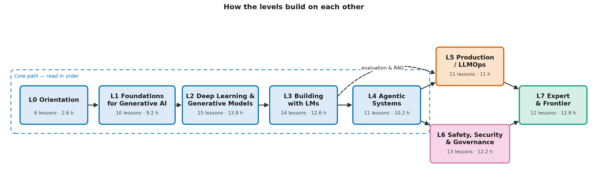

# Curriculum

The full map of the catalog: every lesson, its objective, prerequisites, estimated time and
writing status.

*Levels L0 to L4 run in order. L5 and L6 both build on L4 and can be read in either order. L5 also draws on L3's evaluation and RAG lessons. L7 needs all earlier levels.*

## Status legend

| Status | Meaning |
|---|---|
| planned | In the outline. Not written yet |
| drafted | Written, code runs, automated checks pass |
| reviewed | Passed independent review against the checklist in [CONTRIBUTING.md](CONTRIBUTING.md#lesson-review-checklist) |
| published | Reviewed, merged and linked from the level README |

## Status summary

| Level | Lessons | Planned | Drafted | Reviewed | Published |
|---|---|---|---|---|---|
| L0 Orientation | 6 | 6 | 0 | 0 | 0 |
| L1 Foundations for Generative AI | 10 | 10 | 0 | 0 | 0 |
| L2 Deep Learning & Generative Models | 15 | 15 | 0 | 0 | 0 |
| L3 Building with Language Models | 14 | 14 | 0 | 0 | 0 |
| L4 Agentic Systems | 11 | 11 | 0 | 0 | 0 |
| L5 Production AI Engineering | 11 | 11 | 0 | 0 | 0 |
| L6 Safety, Security & Governance | 13 | 13 | 0 | 0 | 0 |
| L7 Expert & Frontier Topics | 12 | 12 | 0 | 0 | 0 |
| **Total** | **92** | **92** | **0** | **0** | **0** |

## Lessons

Time is the estimated reading time plus running the code. Exercises add roughly 30–50%.
Prerequisites list only direct dependencies.

### Level 0 — Orientation (≈ 2.6 h)

Folder: [curriculum/level-0-orientation/](curriculum/level-0-orientation/README.md)

#### Module 0A · Orientation

| ID | Title | Objective (you will be able to…) | Prereqs | Time | Status |
|---|---|---|---|---|---|
| L0-01 | What Generative AI Is (and Isn't) | Distinguish systems that generate content from systems that classify or predict, and from hand-coded software | — | 20 min | planned |
| L0-02 | AI, ML, Deep Learning, Generative AI: The Nested Map | Place a given system in the right category and explain where generative AI sits | L0-01 | 25 min | planned |
| L0-03 | A Short History: From Rules to Generative Models | Explain the eras that led to today's generative models and why progress came in waves | L0-02 | 30 min | planned |
| L0-04 | Capabilities, Limits and Responsible Use: A First Look | Recognize generative failure modes (fabrication, bias, inconsistency) and when a human must stay in charge | L0-02 | 25 min | planned |
| L0-05 | How to Use This Catalog | Pick a learning path and depth layer (🟢/🟡/🔴) using the placement self-assessment | L0-01 | 25 min | planned |
| L0-06 | Your Toolkit: Running the Code Examples | Set up Python 3.11+ in a virtual environment, run an example, and compare its output with the expected-output comment | L0-05 | 30 min | planned |

### Level 1 — Foundations for Generative AI (≈ 9.2 h)

Folder: [curriculum/level-1-foundations/](curriculum/level-1-foundations/README.md)

#### Module 1A · The math generative models run on

| ID | Title | Objective (you will be able to…) | Prereqs | Time | Status |
|---|---|---|---|---|---|
| L1-01 | Vectors, Matrices and Similarity | Compute dot products, cosine similarity and matrix–vector products in NumPy, and explain why "meaning as a vector" works | L0-06 | 45 min | planned |
| L1-02 | Probability for Generative Models | Compute conditional probabilities, sample from a categorical distribution, and explain generation as repeated sampling | L0-06 | 45 min | planned |
| L1-03 | Information Basics: Entropy, Cross-Entropy, Perplexity, KL | Compute these quantities for small distributions and explain why cross-entropy is the language-model loss | L1-02 | 40 min | planned |
| L1-04 | Derivatives, Gradients and the Chain Rule | Compute gradients and apply the chain rule to a composed function | L1-01 | 45 min | planned |

#### Module 1B · How machines learn

| ID | Title | Objective (you will be able to…) | Prereqs | Time | Status |
|---|---|---|---|---|---|
| L1-05 | Learning from Data: Loss, Gradient Descent and Generalization | Fit a model with gradient descent, use train/validation/test splits, and recognize overfitting and leakage | L1-04 | 50 min | planned |
| L1-06 | Your First Generative Model: A Bigram Character Model | Build a count-based model and a softmax-trained model that generate text one character at a time, and compare them by perplexity | L1-03, L1-05 | 50 min | planned |

#### Module 1C · Neural networks from scratch

| ID | Title | Objective (you will be able to…) | Prereqs | Time | Status |
|---|---|---|---|---|---|
| L1-07 | Neural Networks: From Neuron to MLP | Implement an MLP forward pass and explain why non-linear activations matter | L1-06 | 45 min | planned |
| L1-08 | Backpropagation and a Tiny Autograd Engine | Derive gradients by hand, check them numerically, then implement reverse-mode autodiff over NumPy arrays (reused for TinyLM) | L1-07 | 60 min | planned |
| L1-09 | Training Networks: Optimizers, Initialization, Normalization | Compare SGD, momentum and Adam, and explain initialization, learning-rate schedules, dropout and layer normalization | L1-08 | 50 min | planned |
| L1-10 | Capstone: A Neural Character-Level Language Model | Train an MLP language model with a context window in NumPy, generate text from it, and report its perplexity against the bigram baseline | L1-09 | 120 min | planned |

### Level 2 — Deep Learning & Generative Models (≈ 13.8 h)

Folder: [curriculum/level-2-deep-learning-and-generative-models/](curriculum/level-2-deep-learning-and-generative-models/README.md)

#### Module 2A · Representing language

| ID | Title | Objective (you will be able to…) | Prereqs | Time | Status |
|---|---|---|---|---|---|
| L2-01 | Tokenization: From Text to Numbers | Implement byte-pair encoding from scratch and explain the trade-offs between character, word and subword tokens | L1-06 | 50 min | planned |
| L2-02 | Embeddings: Meaning as Geometry | Train tiny embeddings and explore their geometry with cosine similarity | L2-01, L1-08 | 50 min | planned |
| L2-03 | Before Transformers: RNNs and Their Limits | Implement an RNN step, and explain vanishing gradients and the sequential bottleneck that attention removes | L2-02, L1-09 | 40 min | planned |

#### Module 2B · Attention and the transformer

| ID | Title | Objective (you will be able to…) | Prereqs | Time | Status |
|---|---|---|---|---|---|
| L2-04 | Attention, Explained | Compute scaled dot-product attention by hand and in NumPy | L2-02, L2-03 | 50 min | planned |
| L2-05 | Inside the Transformer Block | Implement multi-head attention, residual connections, layer norm, the MLP sublayer and positional encoding | L2-04 | 55 min | planned |
| L2-06 | Encoders, Decoders and Masking | Compare encoder-only, decoder-only and encoder–decoder designs, and implement a causal mask | L2-05 | 40 min | planned |

#### Module 2C · Training and generation

| ID | Title | Objective (you will be able to…) | Prereqs | Time | Status |
|---|---|---|---|---|---|
| L2-07 | Pretraining Language Models | Explain the next-token objective, how training data is collected and filtered, and the biases that data carries | L2-06, L1-03 | 45 min | planned |
| L2-08 | Scale: Data, Compute and Scaling Laws | Estimate training compute from parameters and tokens, and interpret a scaling-law curve | L2-07 | 45 min | planned |
| L2-09 | From Base Model to Assistant: Post-Training | Explain instruction tuning, reward models and RLHF, preference optimization and principle-based methods at concept level | L2-07 | 50 min | planned |
| L2-10 | How Models Generate: Decoding Strategies | Implement greedy, temperature, top-k and top-p sampling, and explain the KV cache | L2-06 | 45 min | planned |
| L2-11 | Context Windows and Hallucination | Explain why fluent but false output happens and what context limits imply for applications | L2-10, L2-09 | 40 min | planned |

#### Module 2D · Beyond text, and the capstone

| ID | Title | Objective (you will be able to…) | Prereqs | Time | Status |
|---|---|---|---|---|---|
| L2-12 | Families of Generative Models | Compare autoregressive models, VAEs, GANs, flows and diffusion by how they generate, train and fail | L2-10 | 40 min | planned |
| L2-13 | Diffusion Models, Hands-On | Train a toy diffusion model on 2-D points in NumPy and explain noise schedules and guidance | L2-12, L1-09 | 50 min | planned |
| L2-14 | Images as Tokens: Vision and Multimodal Models | Split an image into patch tokens, and explain how contrastive training puts text and images in one embedding space | L2-05, L2-12 | 45 min | planned |
| L2-15 | Capstone: Build TinyLM | Build and train a character-level transformer on the bundled corpus and expose it through the shared LLM interface | L2-10, L1-10 | 180 min | planned |

### Level 3 — Building with Language Models (≈ 12.6 h)

Folder: [curriculum/level-3-building-with-language-models/](curriculum/level-3-building-with-language-models/README.md)

#### Module 3A · Talking to models

| ID | Title | Objective (you will be able to…) | Prereqs | Time | Status |
|---|---|---|---|---|---|
| L3-01 | The LLM Interface: Messages, Roles, Parameters | Use the shared `generate()` interface with MockLLM and TinyLM, and explain why calls are stateless | L2-15 | 35 min | planned |
| L3-02 | Prompting Fundamentals | Write prompts with clear instructions, context, examples and delimiters, and explain why each part helps | L3-01 | 40 min | planned |
| L3-03 | Prompt Patterns | Apply decomposition, few-shot and step-by-step reasoning patterns, and judge when each one helps | L3-02 | 45 min | planned |
| L3-04 | Structured Output | Specify output with a schema, validate it, and implement a repair loop. Explain constrained decoding | L3-02, L2-10 | 45 min | planned |
| L3-05 | Evaluating Prompts and Outputs | Build a small test set and score outputs with exact match, rules, rubrics, precision and recall | L3-03, L1-05 | 45 min | planned |

#### Module 3B · Retrieval

| ID | Title | Objective (you will be able to…) | Prereqs | Time | Status |
|---|---|---|---|---|---|
| L3-06 | Sentence Embeddings and Semantic Search | Build a semantic search over documents and compare it with keyword search | L2-02, L1-01 | 45 min | planned |
| L3-07 | Vector Indexes: Approximate Nearest Neighbours | Implement flat and cluster-based (k-means) indexes and measure the recall–latency trade-off. Explain graph-based indexes and quantization | L3-06 | 55 min | planned |
| L3-08 | RAG I: The Pipeline | Build ingest → chunk → embed → retrieve → generate, with citations | L3-07, L3-04 | 50 min | planned |
| L3-09 | RAG II: Better Retrieval | Implement lexical scoring (BM25), hybrid fusion and reranking, and measure the gain | L3-08 | 50 min | planned |
| L3-10 | RAG III: Failure Modes and Evaluation | Compute recall@k and MRR, check faithfulness, and diagnose five RAG failure modes | L3-09, L3-05 | 45 min | planned |
| L3-11 | Untrusted Input: A First Look at Prompt Injection | Show how retrieved text can hijack instructions and apply two basic mitigations | L3-08 | 35 min | planned |

#### Module 3C · Adapting models, and the capstone

| ID | Title | Objective (you will be able to…) | Prereqs | Time | Status |
|---|---|---|---|---|---|
| L3-12 | Fine-Tuning and Parameter-Efficient Methods | Fine-tune TinyLM fully and with a low-rank adapter (LoRA concept), and compare parameter counts | L2-15, L2-09 | 55 min | planned |
| L3-13 | Choosing an Adaptation Strategy: Prompt, RAG or Fine-Tune | Apply a decision framework to five scenarios and justify each choice | L3-10, L3-12 | 30 min | planned |
| L3-14 | Capstone: An Offline RAG System with an Evaluation Set | Build and evaluate a RAG system over the bundled corpus and report its retrieval and answer metrics | L3-10, L3-11 | 180 min | planned |

### Level 4 — Agentic Systems (≈ 10.2 h)

Folder: [curriculum/level-4-agentic-systems/](curriculum/level-4-agentic-systems/README.md)

#### Module 4A · Agent fundamentals

| ID | Title | Objective (you will be able to…) | Prereqs | Time | Status |
|---|---|---|---|---|---|
| L4-01 | From Chatbot to Agent: What Changes | Place a system on the workflow-to-agent autonomy spectrum and name the new risks each step adds | L3-04 | 30 min | planned |
| L4-02 | Tool and Function Calling | Define tool schemas and implement the call → execute → return loop with MockLLM | L4-01 | 45 min | planned |
| L4-03 | The Agent Loop: Reason, Act, Observe | Implement an agent loop with stop conditions, step budgets and error handling | L4-02 | 50 min | planned |
| L4-04 | Planning, Reflection and Self-Correction | Implement plan-then-execute and a critique-and-revise loop, and measure when reflection helps | L4-03 | 45 min | planned |
| L4-05 | Memory for Agents | Implement context trimming, summarization and a retrieval-based long-term memory | L4-03, L3-08 | 45 min | planned |

#### Module 4B · Systems of agents, and control

| ID | Title | Objective (you will be able to…) | Prereqs | Time | Status |
|---|---|---|---|---|---|
| L4-06 | Multi-Agent Patterns | Implement orchestrator–worker and pipeline patterns, and say when one agent is better than many | L4-04 | 50 min | planned |
| L4-07 | Interoperability Protocols for Tools and Agents | Trace the message flow for capability discovery, tool invocation and agent-to-agent task delegation, using open specifications as the reference | L4-02 | 45 min | planned |
| L4-08 | Human-in-the-Loop and Plan/Apply | Implement dry-run, approval gates, idempotent actions and rollback | L4-03 | 45 min | planned |
| L4-09 | Deterministic Workflows vs Autonomous Agents | Choose between a state machine and an agent for a given task using reliability and cost criteria | L4-06, L4-08 | 35 min | planned |
| L4-10 | Agent Guardrails and Failure Handling | Apply budgets, timeouts, loop detection and least-privilege tool scopes | L4-08, L3-11 | 40 min | planned |
| L4-11 | Capstone: A Multi-Step Agent with Tools and Approval Gates | Build a guarded, approval-gated agent on MockLLM with a test suite | L4-10 | 180 min | planned |

### Level 5 — Production AI Engineering (≈ 11 h)

Folder: [curriculum/level-5-production-ai-engineering/](curriculum/level-5-production-ai-engineering/README.md)

#### Module 5A · Evaluation and observability

| ID | Title | Objective (you will be able to…) | Prereqs | Time | Status |
|---|---|---|---|---|---|
| L5-01 | Evaluation as Engineering: Golden Datasets and Regression Tests | Build a versioned golden set and a regression gate that fails a build | L3-05 | 50 min | planned |
| L5-02 | Model-as-Judge: Methods and Biases | Implement a judge and measure its agreement with human labels and its position and verbosity bias | L5-01 | 45 min | planned |
| L5-03 | Online Evaluation: Feedback, A/B Tests and Drift | Design an online experiment and detect input drift with a simple statistic | L5-01, L1-02 | 45 min | planned |
| L5-04 | Observability: Tracing LLM and Agent Workflows | Instrument an agent with spans that follow the open telemetry conventions for generative AI | L4-03 | 50 min | planned |

#### Module 5B · Performance and cost

| ID | Title | Objective (you will be able to…) | Prereqs | Time | Status |
|---|---|---|---|---|---|
| L5-05 | Inference Fundamentals: Where Time and Memory Go | Compute KV-cache memory and explain prefill vs decode and why decoding is memory-bandwidth bound | L2-10 | 50 min | planned |
| L5-06 | Smaller Models: Quantization and Distillation | Quantize TinyLM weights to 8 and 4 bits and measure the quality loss. Explain distillation | L5-05, L2-15 | 50 min | planned |
| L5-07 | Faster Inference: Caching, Batching, Speculative Decoding | Implement a response cache and simulate the gains from batching and speculative decoding | L5-05 | 50 min | planned |
| L5-08 | Latency Budgets and Cost Modelling | Build a token-based cost and latency model from hypothetical prices | L5-07 | 40 min | planned |

#### Module 5C · Architecture, and the capstone

| ID | Title | Objective (you will be able to…) | Prereqs | Time | Status |
|---|---|---|---|---|---|
| L5-09 | Serving Architecture: Gateways, Rate Limits, Fallbacks, Routing | Implement a token-bucket limiter, a fallback chain and a cost/quality router | L5-08 | 50 min | planned |
| L5-10 | Reference Architectures for Generative AI Systems | Compare four reference patterns (RAG service, agent platform, batch generation, in-app assistant) and their trade-offs | L5-09, L4-11 | 50 min | planned |
| L5-11 | Capstone: Make It Production-Ready | Add evaluation gates, tracing and a cost/latency report to the L3 or L4 capstone | L5-10 | 180 min | planned |

### Level 6 — Safety, Security & Governance (≈ 12.2 h)

Folder: [curriculum/level-6-safety-security-governance/](curriculum/level-6-safety-security-governance/README.md)

#### Module 6A · Security

| ID | Title | Objective (you will be able to…) | Prereqs | Time | Status |
|---|---|---|---|---|---|
| L6-01 | The Generative AI Threat Landscape | Threat-model an LLM application (assets, trust boundaries) and map risks to the OWASP Top 10 for LLM Applications | L4-10 | 45 min | planned |
| L6-02 | Prompt Injection, Direct and Indirect | Demonstrate both kinds against a toy app and explain why no single filter solves the problem | L6-01, L3-11 | 50 min | planned |
| L6-03 | Data Exfiltration, Insecure Output Handling, Excessive Agency | Trace three attack chains end to end and break each one | L6-02 | 45 min | planned |
| L6-04 | Jailbreaks and Model-Level Attacks | Explain jailbreaks, adversarial inputs, training-data poisoning, model extraction and membership inference | L6-01, L1-08 | 45 min | planned |
| L6-05 | AI Supply Chain Security | Assess risks in model files, datasets and dependencies, and apply provenance and pinning controls | L6-01 | 40 min | planned |
| L6-06 | Defense in Depth: Guardrails, Least Privilege, Sandboxing | Design layered controls for an agent and justify each layer | L6-03 | 50 min | planned |
| L6-07 | Red-Teaming Generative AI Systems | Plan and run a scoped red-team exercise and write up findings | L6-06 | 45 min | planned |

#### Module 6B · Responsible AI and governance

| ID | Title | Objective (you will be able to…) | Prereqs | Time | Status |
|---|---|---|---|---|---|
| L6-08 | Bias and Fairness in Generated Output | Measure representational bias with counterfactual prompt sets and explain the limits of each metric | L2-07, L3-05 | 50 min | planned |
| L6-09 | Transparency: Citations, Provenance and Content Credentials | Explain attribution in RAG, watermarking and content-provenance standards, and what each can and can't prove | L3-08 | 45 min | planned |
| L6-10 | Privacy in Generative AI Systems | Detect and minimize personal data in prompts and logs, and explain memorization and differential privacy | L6-01 | 45 min | planned |
| L6-11 | Governance Frameworks: NIST AI RMF, ISO/IEC 42001, EU AI Act | Summarize each framework's scope and structure (marked "As of", not legal advice) | L6-01 | 50 min | planned |
| L6-12 | Model Cards, System Cards and AI Inventories | Write a system card and set up an AI inventory entry | L6-11 | 40 min | planned |
| L6-13 | Capstone: Threat-Model, Red-Team and Document Your Agent | Produce a threat model, red-team report and system card for the L4 capstone | L6-07, L6-12 | 180 min | planned |

### Level 7 — Expert & Frontier Topics (≈ 12.8 h)

Folder: [curriculum/level-7-expert-and-frontier/](curriculum/level-7-expert-and-frontier/README.md)

#### Module 7A · Architectures and scale

| ID | Title | Objective (you will be able to…) | Prereqs | Time | Status |
|---|---|---|---|---|---|
| L7-01 | Reasoning Models and Test-Time Compute | Explain how spending more compute at inference improves answers, and the trade-offs that come with it | L2-09, L3-03 | 50 min | planned |
| L7-02 | Mixture-of-Experts | Implement a top-k router and explain load balancing and the memory vs compute trade-off | L2-05 | 45 min | planned |
| L7-03 | Long Context: Efficient Attention and Position Methods | Compare sparse and linear attention, position-interpolation methods, and long context vs retrieval | L2-05, L5-05 | 50 min | planned |
| L7-04 | Beyond Transformers: State Space Models and Hybrids | Implement a linear recurrence scan and compare its scaling with attention | L2-03, L7-03 | 50 min | planned |
| L7-05 | Training at Scale: Parallelism and Precision | Explain data, tensor and pipeline parallelism and mixed precision, and estimate memory per device | L2-08, L5-05 | 50 min | planned |

#### Module 7B · Learning signals and understanding models

| ID | Title | Objective (you will be able to…) | Prereqs | Time | Status |
|---|---|---|---|---|---|
| L7-06 | Reinforcement Learning Fundamentals | Implement a policy-gradient learner on a bandit task and explain value, policy and reward | L1-09 | 45 min | planned |
| L7-07 | Reinforcement Learning for Language Models | Explain reward models, verifiable rewards, KL regularization and reward hacking | L7-06, L2-09 | 50 min | planned |
| L7-08 | Synthetic Data: Uses, Risks, Model Collapse | Evaluate when synthetic data helps and how it degrades models over generations | L7-07 | 40 min | planned |
| L7-09 | Interpretability I: Probing and Attribution | Train a linear probe on TinyLM activations and interpret what it shows and what it can't | L2-15 | 45 min | planned |
| L7-10 | Interpretability II: Features, Superposition, Circuits | Explain superposition and sparse dictionary learning, and train a toy sparse autoencoder | L7-09 | 50 min | planned |
| L7-11 | The Science of Evaluation: Benchmarks, Contamination, Capability | Critique a benchmark claim for contamination, saturation and validity | L5-02 | 50 min | planned |

#### Module 7C · Synthesis

| ID | Title | Objective (you will be able to…) | Prereqs | Time | Status |
|---|---|---|---|---|---|
| L7-12 | Capstone: Designing an Enterprise Generative AI Platform | Produce and defend an architecture decision record covering every level | L5-11, L6-13 | 240 min | planned |
