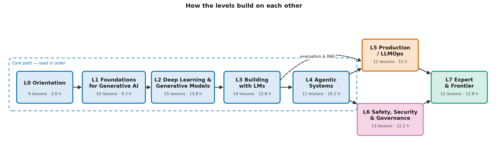

# Generative AI from First Principles

An open, vendor-neutral learning catalog that takes you from no AI knowledge to an expert
understanding of **generative AI**: how it works, how to build with it, and how to run,
secure and govern it.

**Read it on the learning site: <https://rickyb30.github.io/genai-from-first-principles/>**.
The site has interactive quizzes, flashcards with spaced repetition, a reading-depth switch and
progress tracking. It has no accounts or tracking, and your progress stays in your browser.

> **Status: under construction.** New modules are released one at a time. See
> [CURRICULUM.md](CURRICULUM.md) for what's available and what's coming.

## Who this is for

| You are… | You'll get… |
|---|---|
| **New to AI**, and maybe new to code | Solid, hype-free AI literacy. Read only the 🟢 sections |
| **A practitioner** who has used AI tools or built a simple app | The mechanics behind them, with code you can run. Read 🟢 + 🟡 |
| **An aspiring expert**: engineer, architect or technical leader | The depth to design, evaluate, secure and govern AI systems. Read everything, 🟢 + 🟡 + 🔴 |

Every lesson is written in three layers, so all three audiences can use the same material:

- 🟢 **Core idea (everyone).** Intuition, analogies, diagrams and worked examples. No code needed.
- 🟡 **How it works (practitioner).** The mechanics, with a runnable code example.
- 🔴 **Going deeper (expert).** Math, design trade-offs, failure modes at scale and open questions.

## What makes it different

- **Vendor-neutral.** You learn concepts, patterns and open standards, not products. Nothing
  here depends on a particular model provider, cloud or framework, so it stays correct as
  products change.
- **Everything runs offline.** All code is plain Python with NumPy. There are no accounts, API
  keys or paid services. Where a lesson needs a language model, it uses a scripted mock model or
  **TinyLM**, a small transformer you build yourself in Level 2.
- **Built from scratch first.** You implement tokenizers, attention, a transformer, a vector
  index, a RAG pipeline and an agent loop yourself before you see any library version.
- **Accurate and dated.** Primary sources, no invented references, and fast-moving claims
  marked "As of".

## The path



*Levels L0 to L4 run in order. L5 and L6 both build on L4 and can be read in either order. L7 needs all earlier levels.*

| Level | Topic | Lessons |
|---|---|---|
| [0](curriculum/level-0-orientation/README.md) | Orientation: what generative AI is, its history and limits | 6 |
| [1](curriculum/level-1-foundations/README.md) | Foundations for generative AI: the math and neural networks, from scratch | 10 |
| [2](curriculum/level-2-deep-learning-and-generative-models/README.md) | Deep learning and generative models: transformers, training, decoding, diffusion | 15 |
| [3](curriculum/level-3-building-with-language-models/README.md) | Building with language models: prompting, retrieval and RAG, adaptation | 14 |
| [4](curriculum/level-4-agentic-systems/README.md) | Agentic systems: tools, agent loops, memory, multi-agent patterns, human oversight | 11 |
| [5](curriculum/level-5-production-ai-engineering/README.md) | Production AI engineering: evaluation, observability, performance, serving | 11 |
| [6](curriculum/level-6-safety-security-governance/README.md) | Safety, security and governance | 13 |
| [7](curriculum/level-7-expert-and-frontier/README.md) | Expert and frontier topics | 12 |

The full lesson list is in [CURRICULUM.md](CURRICULUM.md).

## Where to start

1. **Not sure of your level?** Take the placement self-assessment in [assessments/](assessments/README.md).
2. **Pick a route for your role** in [LEARNING_PATHS.md](LEARNING_PATHS.md): business leader,
   software developer, data professional, architect or platform engineer, or security and risk professional.
3. **Look up any term** in the [GLOSSARY.md](GLOSSARY.md).
4. **Prefer a guided experience?** Use the [learning site](https://rickyb30.github.io/genai-from-first-principles/),
   which tracks your progress and turns the glossary into flashcards.

## Running the code

You need Python 3.11 or newer. Get the code:

```bash
git clone https://github.com/rickyb30/genai-from-first-principles.git
```

Then, from the repository root, create a virtual environment:

```bash
python -m venv .venv
```

Activate the environment (`source .venv/bin/activate` on macOS and Linux,
`.venv\Scripts\activate` on Windows), then install the pinned dependencies:

```bash
python -m pip install -r requirements.txt
```

Every example runs on its own, with no network access:

```bash
python shared/mock_llm.py
```

Each code file ends its docstring with the exact output you should see.

## Repository layout

| Path | What's there |
|---|---|
| `curriculum/` | The lessons, one folder per level, then one folder per lesson (`README.md`, `code/`, `exercises/`, `diagrams/`) |
| `shared/` | Code every level reuses: the model-agnostic LLM interface, `MockLLM`, the diagram kit, and later `TinyLM` |
| `assessments/` | Placement self-assessment and end-of-level quizzes |
| `assets/` | Catalog-wide images, each drawn by the Python script beside it |

## Contributing

Contributions are welcome. Please read [CONTRIBUTING.md](CONTRIBUTING.md) for the style guide,
lesson structure and review checklist, and follow the [Code of Conduct](CODE_OF_CONDUCT.md).
Report errors or suggest improvements by opening an
[issue](https://github.com/rickyb30/genai-from-first-principles/issues).

**Maintainer:** Ricky Brar ([meetrickyb@gmail.com](mailto:meetrickyb@gmail.com))

## License

- **Lesson content** (text, diagrams, exercises, quizzes): [Creative Commons Attribution 4.0 International](LICENSE) (CC BY 4.0).
- **Code** (every `.py` file, including the code in `curriculum/`, `shared/` and `assets/`): [MIT License](LICENSE-CODE).

You may reuse and adapt both, including commercially, as long as you give credit.
