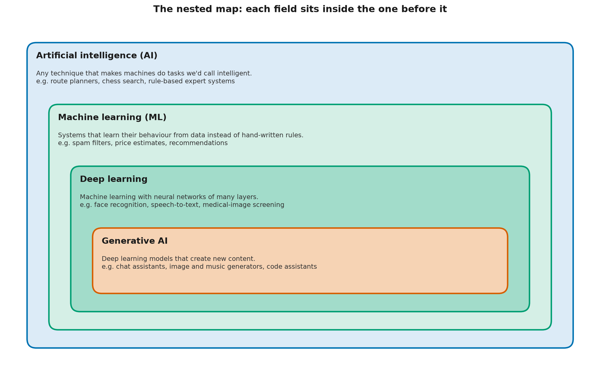

# AI, ML, Deep Learning, Generative AI: The Nested Map

> **TL;DR** — The four terms describe nested fields, like a set of boxes inside boxes. AI is the
> whole field. Machine learning is the part of AI that learns from data. Deep learning is the
> part of machine learning that uses large neural networks. Today's generative AI is the part of
> deep learning that creates new content. Four yes/no questions tell you where any system belongs.

## Learning objectives

By the end you will be able to:

1. **Explain** how AI, machine learning, deep learning and generative AI relate to each other.
2. **Classify** a given system into the innermost category that fits, using four questions.
3. **Define** a neural network, a parameter and a foundation model in plain language.
4. **Identify** two places where the neat nested picture breaks down.

## Why this matters

The four terms are used loosely, and often interchangeably, in news, marketing and even job
descriptions. That causes real confusion. A team asks for "AI" when a few lines of conventional
code would do. A risk review treats a rule-based tool like a large generative model, or the
reverse. A clear map lets you ask the right questions: does this system learn from data? Could
its output be new, and wrong? Each answer changes how you build, test and govern it.

## 🟢 Core idea (everyone)

### Boxes inside boxes



*Each field is a part of the one around it: AI contains machine learning, which contains deep learning, which contains generative AI.*

Artificial intelligence (AI), which you met in L0-01, is the outermost box: any technique that makes a machine do
something we'd call intelligent. That includes methods that learn nothing at all. A route
planner that searches a road map for the shortest path is AI. So is a chess program that
searches millions of moves using a scoring formula a person wrote. AI built from hand-written
rules and logic is often called **symbolic AI**, or a **rule-based system**.

If symbolic AI is built from hand-written rules, how is it different from the conventional
software in L0-01? It isn't, in how it's built. What puts it inside AI is the *kind of task*:
searching, planning, reasoning or conversing, rather than, say, adding up an invoice.

Machine learning (ML) sits inside AI. Here the system's behaviour comes from data. You give
it examples, and a learning method adjusts the system until it handles the examples well. When
each example comes with the right answer (an email labelled "spam"), it's called **supervised
learning**. When the system finds structure in data that has no answers attached, it's called
**unsupervised learning**.

**Deep learning** sits inside machine learning. It uses **neural networks**: models built from
many simple calculating units arranged in **layers**, where each layer transforms the output of
the one before. "Deep" just means many layers. The numbers that a network adjusts during
training are called its **parameters**. A small network might have thousands of them. A large
language model has billions.

Generative AI sits inside deep learning. These are deep learning models whose main job is
creating content: text, images, audio, video or code. Many are **foundation models**: very large
models trained on broad data that can then be adapted to many different tasks.

### An analogy, and where it breaks

Think of nested geographic regions: a continent contains a country, which contains a province,
which contains a city. Every city is in a province, but most of the province isn't the city.
In the same way, every generative AI system is (today) a deep learning system, but most deep
learning isn't generative. Face recognition and speech-to-text are deep learning that judges
or transcribes rather than creates.

**Where the analogy breaks down:** borders between countries are fixed and agreed. Borders
between these fields are fuzzy and partly a matter of convention. Some generative models are
not deep learning at all. The toy word generator in L0-01 learns from data and creates new
text, but it has no neural network. By the box diagram it should sit in "machine learning",
not "generative AI", even though it generates. The 🔴 section returns to this.

### Four questions that place any system

Ask these in order, and stop at the first "no":

| # | Question | If "no", the system is… |
|---|---|---|
| 1 | Does it do a task we'd call intelligent (perceive, reason, plan, decide, create)? | Not AI: conventional software |
| 2 | Does its behaviour come from learning on data, not only from hand-written rules? | AI, but not machine learning |
| 3 | Does it use a neural network with many layers? | Machine learning, but not deep learning |
| 4 | Is its main output new content? | Deep learning, but not generative |
| | All four "yes" | Generative AI |

### Worked examples

| System | Q1 | Q2 | Q3 | Q4 | Where it sits |
|---|---|---|---|---|---|
| Tax calculator applying fixed formulas | no | | | | Not AI |
| Chess program with a hand-written scoring formula | yes | no | | | AI, not ML |
| Spam filter trained on labelled emails by counting words | yes | yes | no | | ML, not deep learning |
| Photo app that recognizes faces with a deep network | yes | yes | yes | no | Deep learning, not generative |
| Chat assistant built on a large language model | yes | yes | yes | yes | Generative AI |

Question 1 is the vague one. Reasonable people disagree about where "intelligent" starts. A
motion-sensor light that switches on when something moves makes a decision, but almost nobody
calls it AI. When
in doubt, questions 2–4 are the ones that matter in practice: they tell you how the system was
built, and so how it can fail.

## 🟡 How it works (practitioner)

### The four questions as code

[code/where_does_it_fit.py](code/where_does_it_fit.py) turns the table into a function. Each
system is described by four booleans, and `place` walks inward through the map:

```python
def place(s: System) -> str:
    if not s.does_ai_task:
        return "Not AI: conventional software"
    if not s.learns_from_data:
        return "AI, but not machine learning"
    if not s.deep_network:
        if s.generates:
            return "Machine learning: a simple generative model (not deep learning)"
        return "Machine learning, but not deep learning"
    if s.generates:
        return "Generative AI (deep learning that creates content)"
    return "Deep learning, but not generative"
```

Run it from this lesson's folder with `python code/where_does_it_fit.py`:

```text
Tax calculator applying fixed formulas                   ->  Not AI: conventional software
Chess program searching moves with hand-written scoring  ->  AI, but not machine learning
Spam filter that counts words in labelled emails         ->  Machine learning, but not deep learning
Word-pair text generator (like L0-01's)                  ->  Machine learning: a simple generative model (not deep learning)
Photo app that recognizes faces with a deep network      ->  Deep learning, but not generative
Chat assistant built on a large language model           ->  Generative AI (deep learning that creates content)
Image generator that turns a description into a picture  ->  Generative AI (deep learning that creates content)
```

Notice the fourth line. The code needed an extra branch for a system that generates but isn't
deep learning, because the strict box diagram has no place for it.

### What actually differs between the boxes

The labels matter less than what changes as you move inward:

| Moving inward to… | What you gain | What you take on |
|---|---|---|
| Machine learning | Handles patterns too complex to write as rules | Behaviour depends on training data quality; failures are harder to predict |
| Deep learning | Learns directly from raw text, pixels and audio | Needs much more data and computation; harder to explain why it decided something |
| Generative AI | Produces open-ended content, works across many tasks | Output can be new *and* wrong; harder to test, because there's no single right answer |

### Common pitfalls

- **Calling everything "AI".** Many products marketed as AI are mostly conventional software.
  Ask what is learned, from what data, and where.
- **Assuming deep learning is always better.** For small, structured problems (a few columns in
  a spreadsheet), simpler machine learning often matches or beats deep learning, and is far
  easier to explain.
- **Assuming "generative" means "deep".** True for the systems in the news today, but not true
  by definition, as the word-pair generator shows.

## 🔴 Going deeper (expert)

### Where the nested map breaks down

**1. Generative is a property, not a box.** Formally, a generative model is one that models
the data distribution $p(x)$ and can sample from it (L0-01). By that definition, generative
models long predate deep learning. Andrey Markov analyzed sequences of vowels and consonants in
Pushkin's novel in verse *Eugene Onegin* in 1913; Claude Shannon generated English-like text from letter and word statistics in 1948
(L0-03 recreates it); hidden Markov models were the backbone of speech recognition for decades.
"Generative AI" in today's usage means *deep* generative models, so the nested picture
describes current usage, not a mathematical necessity.

**2. Many systems are hybrids.** A route planner might use learned traffic predictions (ML)
inside a classic search algorithm (symbolic AI). A chat assistant combines a generative model
with retrieval, rules and filters. Placing "the system" on the map is less useful than placing
each component, because each component fails and is tested differently.

**3. Learning paradigms cut across the boxes.** Large language models are mostly trained with
**self-supervised learning**: the labels come from the data itself (the "answer" for each
position in a text is simply the next token). That doesn't fit the classic supervised versus
unsupervised split. Post-training then adds supervised and reinforcement learning on top
(L2-09, L7-07).

### Narrow and general AI

Most researchers would describe every AI system in use today (as of November 2026) as
**narrow AI**: built and validated for particular ranges of tasks, even when that range is
wide. Some argue that today's largest models already show meaningful generality, which is part of
the debate below. **Artificial general
intelligence (AGI)** usually refers to a hypothetical system that matches or exceeds people
across essentially all cognitive tasks.

> **Open debate (as of November 2026):** there is no agreed definition of AGI, no agreed test
> for it, and no consensus on whether or when it could be built. Claims in either direction are
> predictions, not established facts. This catalog teaches what current systems do and how to
> evaluate them, which stays useful whichever way that debate goes.

### Why the classification matters in production

The map predicts the engineering and governance work a system needs:

- **Testing.** Rule-based systems can be tested against their specification. Learned systems
  need held-out evaluation data. Generative systems need evaluation of open-ended output,
  which is still an active research area (Level 5, L7-11).
- **Explainability.** You can read a rule. You can inspect a small model's learned weights.
  Explaining a deep network's individual decisions is much harder (L7-09, L7-10).
- **Risk.** Frameworks such as the EU AI Act (adopted in 2024) regulate by *use* and *risk level* more than by
  technique, but the technique still determines which failure modes you must control (L6-11).

## Common misconceptions

- **Myth:** AI and machine learning are the same thing.
  **Reality:** Machine learning is one part of AI. Search, planning and rule-based reasoning are
  AI too, and they learn nothing.
- **Myth:** Deep learning is a completely different field from machine learning.
  **Reality:** Deep learning is machine learning with large, many-layered neural networks.
  The core ideas (data, a model, training to reduce errors) are the same.
- **Myth:** Generative AI can only produce text.
  **Reality:** Deep generative models also produce images, audio, video, code, 3-D shapes and
  more. L2-12 to L2-14 cover the main families.
- **Myth:** Today's systems are general intelligences.
  **Reality:** They can be broadly capable and still fail on tasks a child finds easy. Whether
  general intelligence is near is an open debate, not a settled fact.

## Hands-on exercise

**Goal:** place six more systems on the map, and notice which questions are hard to answer.

Open [exercises/place_these.py](exercises/place_these.py), replace every `None` with `True` or
`False`, and run it. No coding? Answer the four questions on paper for each system:

1. A thermostat that switches heating on below 19 °C
2. A route planner that searches a road map for the shortest path
3. Speech-to-text on a phone, using a deep network
4. A music generator that composes new melodies with a deep network
5. A house-price estimator fitted to past sales with a straight line
6. A rule-based chatbot that fills in templates like "Tell me more about X"

<details>
<summary>Solution</summary>

The full solution, with reasoning, is in
[exercises/solutions/place_these.py](exercises/solutions/place_these.py):

```text
Thermostat          ->  Not AI: conventional software
Route planner       ->  AI, but not machine learning
Speech-to-text      ->  Deep learning, but not generative
Music generator     ->  Generative AI (deep learning that creates content)
House-price line    ->  Machine learning, but not deep learning
Rule-based chatbot  ->  AI, but not machine learning
```

The two worth discussing: the **rule-based chatbot** produces text, but from hand-written
templates, so it's symbolic AI rather than generative AI. The **house-price line** is simple,
but fitting it to data *is* machine learning. "Simple" and "learned" are different questions.

</details>

## Check your understanding

1. Which statement about the four fields is correct?

   - A. All machine learning is deep learning
   - B. All deep learning is machine learning
   - C. All AI is machine learning

   <details>
   <summary>Answer</summary>

   **B.** Deep learning is the part of machine learning that uses many-layered neural networks.
   A is backwards: much machine learning isn't deep. C is wrong because search, planning and
   rule-based systems are AI without learning.

   </details>

2. A delivery company's system picks the order of stops using a classic search algorithm, with
   travel times predicted by a model trained on past trips. Where does it belong?
   *(choose all that apply)*

   - A. It uses AI without machine learning (the search)
   - B. It uses machine learning (the travel-time model)
   - C. It is generative AI

   <details>
   <summary>Answer</summary>

   **A, B.** It's a hybrid: a symbolic search component and a learned prediction component. It
   isn't generative, because its output is a choice of order, not new content. Placing each
   component on the map is more useful than placing the whole system.

   </details>

3. Which statements are correct? *(choose all that apply)*

   - A. A model's parameters are the numbers adjusted during training that determine its behaviour
   - B. A model's parameters are the settings a user chooses before running it
   - C. A foundation model is a very large model trained on broad data that can be adapted to many tasks
   - D. In a neural network, each layer transforms the output of the layer before it

   <details>
   <summary>Answer</summary>

   **A, C, D.** Parameters are the learned numbers (A). Settings chosen by people before training
   (B) are a different thing, often called hyperparameters. A foundation model (C) is defined by
   its size, broad training data and adaptability, not by any single task. Layers (D) are the
   structure that holds the parameters.

   </details>

4. Why does the L0-01 word-pair generator not fit neatly into the box diagram?

   <details>
   <summary>Model answer</summary>

   It learns from data and creates new text, so it's a generative model, but it has no neural
   network, so it isn't deep learning. The box diagram puts all of generative AI inside deep
   learning, which matches how the term is used today, but generative models existed long
   before deep learning.

   </details>

5. **Explain it to a colleague:** a manager asks, "Is our new invoice-matching tool AI or
   machine learning?" Explain how you'd find out, and why the answer matters.

   <details>
   <summary>Model answer</summary>

   Ask whether its behaviour comes from rules people wrote or from learning on past invoices,
   and whether it creates content or just matches and classifies. If it's rule-based, it can be
   tested directly against its rules. If it learned from data, its quality depends on that data,
   and it needs evaluation on examples it hasn't seen. The answer tells you how it can fail and
   how to test and govern it.

   </details>

## Key terms

- [Artificial general intelligence (AGI)](../../../GLOSSARY.md#artificial-general-intelligence-agi)
- [Deep learning](../../../GLOSSARY.md#deep-learning)
- [Foundation model](../../../GLOSSARY.md#foundation-model)
- [Layer](../../../GLOSSARY.md#layer)
- [Narrow AI](../../../GLOSSARY.md#narrow-ai)
- [Neural network](../../../GLOSSARY.md#neural-network)
- [Parameter](../../../GLOSSARY.md#parameter)
- [Rule-based system](../../../GLOSSARY.md#rule-based-system)
- [Self-supervised learning](../../../GLOSSARY.md#self-supervised-learning)
- [Supervised learning](../../../GLOSSARY.md#supervised-learning)
- [Symbolic AI](../../../GLOSSARY.md#symbolic-ai)
- [Unsupervised learning](../../../GLOSSARY.md#unsupervised-learning)

## Further reading

- 🟢 **Elements of AI, chapter 1** — University of Helsinki and MinnaLearn. Explains the
  relationship between AI, machine learning and deep learning for a general audience.
  <https://www.elementsofai.com/>
- 🟡 **Deep Learning** — Ian Goodfellow, Yoshua Bengio and Aaron Courville (MIT Press, 2016).
  The introduction (chapter 1) gives the classic nested view and its history. Free to read online.
  <https://www.deeplearningbook.org/>
- 🔴 **On the Opportunities and Risks of Foundation Models** — Bommasani et al. (2021). Coined
  the term "foundation model" and discusses what makes these models different.
  <https://arxiv.org/abs/2108.07258>

## Next

- **Next lesson:** [L0-03 A Short History: From Rules to Generative Models](../03-a-short-history/README.md)
- **Related:** Level 1 builds neural networks from scratch. L2-12 compares the families of
  generative models, including ones that aren't language models.
