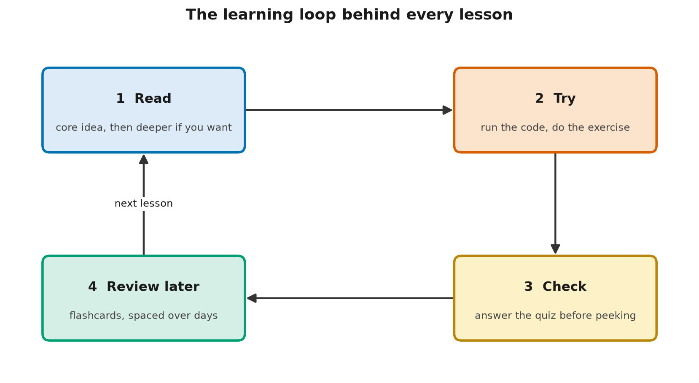

# How to Use This Catalog

> **TL;DR** — The catalog has 8 levels, and every lesson is written in three depth layers: 🟢 for
> everyone, 🟡 for practitioners and 🔴 for experts. Pick a learning path for your role, read at
> the depth you need, and follow a simple loop for each lesson: read, try, check yourself, then
> review a few days later. That loop is built on two of the best-supported findings in learning science.

## Learning objectives

By the end you will be able to:

1. **Describe** how the catalog is organized into levels, modules, lessons and depth layers.
2. **Choose** a starting level and a learning path that fits your role and background.
3. **Explain** why the catalog uses quizzes and spaced flashcards, citing retrieval practice and spacing.
4. **Plan** a realistic study schedule for your chosen path.

## Why this matters

A catalog of 92 lessons is a lot to face without a plan. Two common reasons people stall in
self-study are material pitched at the wrong level, and reading without practising, then
forgetting. Spending half an hour on how to use the catalog well can save many hours later.

## 🟢 Core idea (everyone)

### How the catalog is organized

| Unit | What it is | Example |
|---|---|---|
| **Level** | A major stage, from orientation (0) to frontier topics (7) | Level 2: Deep Learning & Generative Models |
| **Module** | A group of 3–7 related lessons | Module 2B: Attention and the transformer |
| **Lesson** | One topic, about 20–60 minutes (capstones longer) | L2-04: Attention, Explained |

Lessons have IDs like **L2-04**: level 2, lesson 4. Each lesson lists its **prerequisites**, the
lessons you should read first. The full map, with every lesson and its status, is in
[CURRICULUM.md](../../../CURRICULUM.md).

### Three depth layers in every lesson

Every lesson has the same three core sections:

| Layer | Who it's for | What you get |
|---|---|---|
| 🟢 **Core idea** | Everyone | Intuition, an analogy, a diagram and a worked example. No code or math needed |
| 🟡 **How it works** | Practitioners | The mechanics, step by step, with runnable code and common pitfalls |
| 🔴 **Going deeper** | Aspiring experts | Math, design trade-offs, failure modes at scale and open questions |

You can read only the 🟢 sections across the whole catalog and come away with solid, hype-free AI
literacy. Developers will usually want 🟢 and 🟡. Architects, researchers and technical leaders
should read all three.

**An analogy.** The layers work like zoom levels on a map. Zoomed out, you see the whole country
and how the regions connect. Zoom in, and you see streets, then individual buildings.

**Where the analogy breaks down:** on a map, every zoom level shows the same territory in less or
more detail. Here, the deeper layers add things the 🟢 layer doesn't contain at all: code, math
and open research questions. Reading only 🟢 gives you true understanding, but not the ability to
build or analyze systems yourself.

### Choosing where to start

A **learning path** is a recommended route through the lessons for a particular goal.
[LEARNING_PATHS.md](../../../LEARNING_PATHS.md) has routes for five roles: business leader,
software developer, data professional, architect or platform engineer, and security and risk
professional. Each tells you which lessons to read and at what depth.

A full placement self-assessment is planned for the [assessments](../../../assessments/README.md)
folder. Until it's ready, use this quick check:

| If this describes you… | Start at |
|---|---|
| New to AI and to programming | Finish Level 0, then read Levels 1–3 at 🟢 |
| You've used AI tools but never looked inside one | Level 0, then Level 1 at 🟢 + 🟡 |
| You can write Python, and you know what a vector and a probability are | L1-06, skimming L1-01 to L1-05 |
| You've trained a neural network before | Level 2 |
| You've built applications on language models | Level 3 at 🔴, or jump to Levels 4–6 |

### The learning loop



*Each lesson follows the same loop: read, try, check yourself, then review later, before moving on.*

1. **Read** the 🟢 section, and deeper layers if you want them.
2. **Try** it: run the code or do the exercise (on paper is fine).
3. **Check** yourself with the five quiz questions. Write or say your answer *before* opening it.
4. **Review later**: revisit the key terms a few days later, then again a week or two after that.

Steps 3 and 4 feel slower than re-reading. They're also far more effective, for two well-tested reasons:

- **Retrieval practice.** Recalling something from memory strengthens it much more than reading it
  again. Answering a quiz question is retrieval practice.
- **Spaced repetition.** Reviewing material at increasing intervals (after one day, then a few
  days, then a week or more) makes it last far longer than the same time spent in one session.

### A worked example: spacing in numbers

This lesson's code simulates a learner studying 20 key terms over 28 days with the **Leitner
system**, a simple spaced-repetition method using five boxes. Every card starts in box 1. Each
time you remember a card, it moves up a box and waits longer before its next review (1, 2, 4, 8,
then 16 days). Each time you forget it, it goes back to box 1.

| Week | Reviews |
|---|---|
| 1 | 78 |
| 2 | 36 |
| 3 | 31 |
| 4 | 14 |
| **Total** | **159** |

Reviewing all 20 cards every day for 28 days would take 560 reviews. The Leitner schedule took
159, under a third, and ended with 15 of the 20 cards in the top box. The simulated learner's
chances of remembering are made-up numbers for illustration, so the exact figures don't matter.
The shape does: the effort drops week by week as cards become well learned.

### What you need

- **For 🟢 sections:** nothing but a browser.
- **For 🟡 and 🔴 code:** Python 3.11 or newer, and a few free packages. L0-06 walks you through
  setup.
- **No accounts or paid services, ever.** Where a lesson needs a language model, it uses
  **MockLLM**, a scripted stand-in that gives fixed, predictable replies, or **TinyLM**, a small
  language model you build yourself in Level 2. Every example runs offline.

## 🟡 How it works (practitioner)

### Simulating the Leitner system

[code/leitner_boxes.py](code/leitner_boxes.py) implements the schedule in a few lines. Each card
has a box and a due day:

```python
INTERVAL_DAYS = {1: 1, 2: 2, 3: 4, 4: 8, 5: 16}

for c in todays_cards:
    if rng.random() < RECALL_CHANCE[box[c]]:   # remembered
        box[c] = min(box[c] + 1, 5)
    else:                                      # forgotten
        box[c] = 1
    due[c] = day + INTERVAL_DAYS[box[c]]
```

Run it from this lesson's folder with `python code/leitner_boxes.py`. Try changing
`INTERVAL_DAYS` or `RECALL_CHANCE` and see how the total number of reviews and the final boxes
change. The catalog's planned companion website will use the same algorithm for glossary
flashcards. Until then, you can make paper flashcards from the glossary and sort them into boxes.

### Getting the most from code examples

- **Run before you read.** Run the example, look at the output, *then* read the code that produced
  it. You'll know what each part is for.
- **Predict, then check.** Before changing a value, predict what will happen. Being wrong is
  where the learning happens.
- **Compare with the expected output.** Every code file ends its docstring with the exact output
  you should see. L0-06 explains why.
- **Break it on purpose.** Delete a line and see what fails. It's the fastest way to learn what
  each line is for.

### Conventions used throughout

| You'll see | It means |
|---|---|
| **Bold term** on first use | A new term, defined right there and added to the [glossary](../../../GLOSSARY.md) |
| "As of Month YYYY" | A claim that may change as the field moves. Check whether it's still true |
| "Open question" or "Open debate" | Researchers disagree, or the evidence isn't settled |
| "Where the analogy breaks down" | The limit of a comparison, so it doesn't mislead you |
| `TODO(verify)` | A claim the authors couldn't confirm yet. Treat it with caution |

### Common pitfalls

- **Reading every 🔴 section first time through.** On a first pass, read at the depth your path
  suggests. Come back for 🔴 later.
- **Skipping the quizzes.** They take two minutes, and they're where most of the learning sticks.
- **Binge-reading.** Twenty lessons in a weekend feels productive, but spacing beats cramming.

## 🔴 Going deeper (expert)

### How strong is the learning-science evidence?

Retrieval practice and spaced practice are among the best-replicated findings in cognitive
psychology. A 2013 review by Dunlosky and colleagues rated ten common study techniques, and gave
only two a "high utility" rating: **practice testing** and **distributed practice** (spacing).
Re-reading and highlighting, the techniques students use most, were rated low. Classic studies
include Roediger and Karpicke (2006), where students who practised recalling a text remembered
more a week later than students who re-read it, even though the re-reading group predicted they
would remember more. On a test just five minutes later, re-reading did slightly better. That's
why re-reading *feels* effective: its benefit shows up immediately and then fades.

Two caveats are worth knowing. Most studies use school or university material, so effect sizes for
self-directed adult learning are less certain. And spacing intervals are an active research topic:
the best gap depends on how long you need to remember the material. The Leitner intervals here
are a reasonable, simple default, not an optimum.

### A widespread myth: learning styles

Many people believe they learn best in one "style" (visual, auditory and so on), and that
material should be matched to it. A 2008 review by Pashler and colleagues found no credible
evidence that matching instruction to a preferred style improves learning. This catalog uses
diagrams, text, code and quizzes for everyone, because different *content* suits different
formats, not different people.

### Reading the primary sources

The 🔴 sections cite papers and standards directly. A useful method, from S. Keshav's short
guide *How to Read a Paper*, is to read in three passes: first the title, abstract,
introduction, headings and conclusions, with a glance at the references (five to ten minutes);
then the figures and main argument; and only then, if it matters to you, the full details. The
first pass tells you whether to read on, and many papers never need the second or third.

When a lesson says "As of" or flags an open question, treat it as an invitation: check the
current state of the evidence yourself. The field moves faster than any catalog can.

### Contributing back

Found an error, an unclear explanation, or a claim that's out of date? Open an issue on the
catalog's GitHub repository. Careful corrections from readers are one of the main ways an open
catalog stays accurate. [CONTRIBUTING.md](../../../CONTRIBUTING.md) explains how lessons are written and reviewed.

## Common misconceptions

- **Myth:** Re-reading a lesson is the best way to learn it.
  **Reality:** Testing yourself and spacing out your reviews work much better, even though they
  feel harder.
- **Myth:** The 🟢 sections are a simplified, less accurate version.
  **Reality:** They're less detailed, but they aim to be just as accurate at their level of
  detail. The deeper layers add mechanism, not corrections.
- **Myth:** You need strong math to learn about AI.
  **Reality:** The 🟢 layer needs none. Level 1 teaches the math the deeper layers use, from the
  ground up.
- **Myth:** People learn best when material matches their learning style.
  **Reality:** Reviews of the evidence haven't found support for this.

## Hands-on exercise

**Goal:** turn your chosen learning path into a realistic schedule.

Open [exercises/plan_your_study.py](exercises/plan_your_study.py). Set the hours for your path
(from LEARNING_PATHS.md) and the hours you can give each week, then implement `weeks_needed()`.
The catalog's rough estimate is that exercises add 30–50% to the reading and code time listed in
[CURRICULUM.md](../../../CURRICULUM.md). The exercise uses 40%. No coding? Do the same sum on paper.

<details>
<summary>Solution</summary>

The full solution is in
[exercises/solutions/plan_your_study.py](exercises/solutions/plan_your_study.py). For the
55-hour software developer path:

```text
path: 55 h of reading and code, about 77 h with exercises
 2.0 hours a week -> about 39 weeks
 4.0 hours a week -> about 20 weeks
 8.0 hours a week -> about 10 weeks
```

A steady four hours a week finishes the path in about five months. A regular weekly slot also
gives you spacing for free.

</details>

## Check your understanding

1. You're a project manager who wants to understand generative AI well enough to judge
   proposals, without coding. Which layers should you read?

   - A. Only 🟢 sections
   - B. 🟢 and 🟡 sections
   - C. Only 🔴 sections

   <details>
   <summary>Answer</summary>

   **A.** The 🟢 layer is written to give solid literacy without code or math. 🟡 adds code you
   don't need for your goal. 🔴 builds on both earlier layers, so it isn't a substitute for them.

   </details>

2. Which study habits does the research summarized in this lesson support?
   *(choose all that apply)*

   - A. Answering quiz questions before looking at the answers
   - B. Reviewing key terms again after a few days, then after a week or two
   - C. Re-reading a lesson several times in one evening
   - D. Matching material to your personal learning style

   <details>
   <summary>Answer</summary>

   **A, B.** A is retrieval practice, and B is spaced repetition, the two techniques with the
   strongest evidence. C (massed re-reading) was rated low utility, and D (learning styles)
   isn't supported by the evidence.

   </details>

3. In the Leitner system, what happens to a card in box 4 that you forget?

   - A. It moves down to box 3
   - B. It goes back to box 1 and is reviewed again tomorrow
   - C. It stays in box 4

   <details>
   <summary>Answer</summary>

   **B.** Any forgotten card restarts in box 1, so it gets frequent practice until it's learned
   again. Some variants move a card down one box instead (A), but this catalog uses the simpler
   rule.

   </details>

4. A lesson is listed as **L3-08**, with prerequisites L3-07 and L3-04. What does that tell you?

   - A. It's the 8th lesson in Level 3, and you should read L3-07 and L3-04 first
   - B. It's the 3rd lesson in Level 8, and L3-07 and L3-04 are optional extras
   - C. It takes 3 hours and 8 minutes

   <details>
   <summary>Answer</summary>

   **A.** Lesson IDs are level, then lesson number: L3-08 is Level 3, lesson 8. Prerequisites are
   the lessons it builds on, so read them first unless you already know their content. IDs say
   nothing about time (C); each lesson lists its estimated time separately.

   </details>

5. **Explain it to a colleague:** a colleague says they'll "just read through the whole catalog
   twice". Explain, in two or three sentences, a better approach and why it works.

   <details>
   <summary>Model answer</summary>

   Reading twice feels productive but is one of the least effective ways to learn. Instead, after
   each lesson, try to answer the quiz from memory before checking, and review the key terms again
   a few days and a couple of weeks later. Recalling information and spacing out reviews both
   strengthen memory far more than re-reading.

   </details>

## Key terms

- [Leitner system](../../../GLOSSARY.md#leitner-system)
- [Learning path](../../../GLOSSARY.md#learning-path)
- [MockLLM](../../../GLOSSARY.md#mockllm)
- [Prerequisite](../../../GLOSSARY.md#prerequisite)
- [Retrieval practice](../../../GLOSSARY.md#retrieval-practice)
- [Spaced repetition](../../../GLOSSARY.md#spaced-repetition)
- [TinyLM](../../../GLOSSARY.md#tinylm)

## Further reading

- 🟢 **Improving Students' Learning With Effective Learning Techniques** — J. Dunlosky,
  K. A. Rawson, E. J. Marsh, M. J. Nathan and D. T. Willingham (2013). *Psychological Science in
  the Public Interest*, 14(1). Rates ten study techniques by the strength of their evidence.
  <https://doi.org/10.1177/1529100612453266>
- 🟡 **Test-Enhanced Learning: Taking Memory Tests Improves Long-Term Retention** —
  H. L. Roediger III and J. D. Karpicke (2006). *Psychological Science*, 17(3). The classic
  retrieval-practice experiment. <https://doi.org/10.1111/j.1467-9280.2006.01693.x>
- 🟡 **Learning Styles: Concepts and Evidence** — H. Pashler, M. McDaniel, D. Rohrer and R. Bjork
  (2008). *Psychological Science in the Public Interest*, 9(3). Why matching material to
  "learning styles" isn't supported. <https://doi.org/10.1111/j.1539-6053.2009.01038.x>
- 🔴 **How to Read a Paper** — S. Keshav (2007). *ACM SIGCOMM Computer Communication Review*,
  37(3). The three-pass method for reading research papers.
  <https://doi.org/10.1145/1273445.1273458>

## Next

- **Next lesson:** [L0-06 Your Toolkit: Running the Code Examples](../06-your-toolkit/README.md)
- **Related:** [LEARNING_PATHS.md](../../../LEARNING_PATHS.md) for role-based routes, and
  [CURRICULUM.md](../../../CURRICULUM.md) for the full map.
