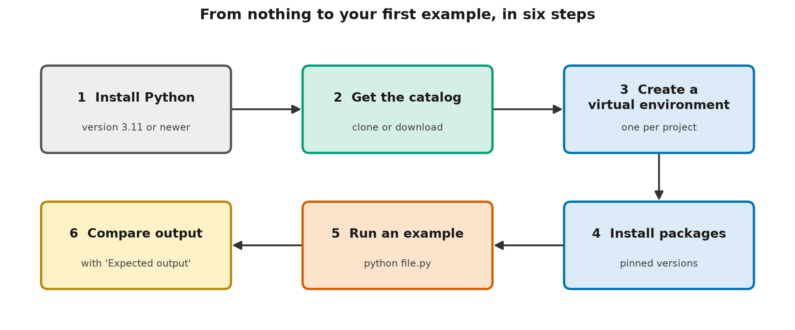

# Your Toolkit: Running the Code Examples

> **TL;DR** — To run the catalog's code you need Python 3.11 or newer, a copy of the catalog, a
> virtual environment, and two free packages (NumPy and matplotlib). Setup takes about fifteen
> minutes. Every example then runs offline with one command, and prints exactly the output
> written at the end of its docstring, so you always know whether it worked.

## Learning objectives

By the end you will be able to:

1. **Set up** Python, a virtual environment and the catalog's pinned packages on your computer.
2. **Run** an example and **compare** its output with the documented expected output.
3. **Explain** why the catalog fixes random seeds and pins package versions.
4. **Diagnose** common setup problems from their symptoms.

## Why this matters

The 🟡 and 🔴 layers of every lesson after this one include code. Code you can't run is code you
can't experiment with, and experimenting is where understanding forms. The habits in this lesson
also matter beyond learning: reproducible environments and checkable outputs are exactly how
professional AI teams keep their work trustworthy.

If you only plan to read 🟢 sections, you can skip the setup. Skim the 🟢 section anyway: it
explains what you'll see in code examples.

## 🟢 Core idea (everyone)

### The toolkit

| Tool | What it is | Why you need it |
|---|---|---|
| **Python** | A popular, free programming language, and the program that runs code written in it | Every example is written in Python |
| **Terminal** | A text window where you type commands (also called a command line). The program inside it that reads your commands is the shell | You run examples by typing a command |
| **The catalog** | This repository, a folder of lessons and code | The examples live here |
| **Virtual environment** | A private folder of packages for one project | Keeps the catalog's packages separate from everything else |
| **Packages** | Add-on code libraries for Python | NumPy (fast math on lists of numbers) and matplotlib (plots) |
| **A text editor** | Any program for editing plain text | To read and change the code |

A **package** is a bundle of ready-made code that other people wrote and shared. **NumPy** is
the package almost every AI project uses: it does arithmetic on whole lists of numbers, called
**arrays**, at once and very quickly.

### Six steps



*Setup is six steps: install Python, get the catalog, create a virtual environment, install packages, run an example, and compare its output.*

### Why a virtual environment?

Different projects need different versions of the same package. A **virtual environment** gives
each project its own private set of packages, so installing something for one project can't
break another.

**An analogy.** It's like giving each project its own toolbox instead of sharing one big
toolbox in the garage. Whatever you add to one box doesn't change what's in the others.

**Where the analogy breaks down:** a toolbox is physically separate, but a virtual environment
isn't a security barrier. Code you run inside it can still read your files and use your network.
It separates *packages*, not *permissions*.

### The "expected output" contract

Every code file in the catalog ends its opening comment (its **docstring**) with the exact output
you should see. For example, this lesson's setup check promises:

```text
[ok] Python 3.11 or newer
[ok] NumPy installed
[ok] matplotlib installed
[ok] catalog's shared/ folder found
Everything is ready.
```

If your output matches, the example works on your computer. If it doesn't, something is
different, and the difference tells you where to look.

This only works if the code is **deterministic**: it gives the same output every time it runs.
Many examples use random numbers (to sample text, for instance). They're made repeatable with a
**random seed**: a starting number for the random-number generator. The same seed always gives the
same sequence of "random" choices.

### A worked example with real numbers

[code/hello_numpy.py](code/hello_numpy.py) takes one week of noon temperatures from Brindlewick's
weather station, in degrees Celsius:

| Mon | Tue | Wed | Thu | Fri | Sat | Sun |
|---|---|---|---|---|---|---|
| 4.0 | 6.5 | 7.0 | 3.5 | 2.0 | 5.0 | 8.0 |

With NumPy, one line converts all seven to Fahrenheit, using °F = °C × 9/5 + 32. For Monday,
4.0 × 9/5 + 32 = 39.2. The program prints the whole week at once:

```text
in °F: [39.2 43.7 44.6 38.3 35.6 41.  46.4]
```

The mean is (4.0 + 6.5 + 7.0 + 3.5 + 2.0 + 5.0 + 8.0) / 7 = 36.0 / 7 ≈ 5.14 °C. Two days were
below 4 °C (Thursday and Friday). These are exactly the operations, on much bigger arrays, that
AI models perform billions of times.

## 🟡 How it works (practitioner)

### Step by step

**1. Install Python 3.11 or newer.** Download it from <https://www.python.org/downloads/>, or use
your operating system's package manager. Then check the version in a terminal:

```bash
python --version
```

On macOS and Linux the command may be `python3`. On Windows, `py --version` also works. You need
3.11 or newer.

**2. Get the catalog.** If you have Git, clone the repository:

```bash
git clone https://github.com/rickyb30/genai-from-first-principles.git
```

Otherwise, download it as a ZIP file from the repository page and unzip it. Then move into the
folder:

```bash
cd genai-from-first-principles
```

**3. Create a virtual environment** named `.venv` inside the catalog folder:

```bash
python -m venv .venv
```

Use `python3` instead of `python` on macOS and Linux if that's what step 1 needed. On Windows,
`py -m venv .venv` also works.

**4. Activate it, then install the packages.** Activation makes `python` mean "the Python in this
environment". On macOS and Linux:

```bash
source .venv/bin/activate
```

On Windows, in Command Prompt:

```bat
.venv\Scripts\activate.bat
```

On Windows, in PowerShell:

```powershell
.venv\Scripts\Activate.ps1
```

Your prompt usually shows `(.venv)` once it's active. Then install the pinned packages:

```bash
python -m pip install -r requirements.txt
```

The `requirements.txt` at the catalog's root covers every level. Each level folder also has its
own `requirements.txt` with the same pinned versions, if you'd rather install only one level's needs.

**5. Run the setup check:**

```bash
python curriculum/level-0-orientation/06-your-toolkit/code/check_setup.py
```

**6. Compare** the output with the expected output above. Then try `hello_numpy.py` the same way.

Examples work from any folder. Ones that import shared code find the catalog's `shared/` folder
by walking up from their own location, so you never need to install the catalog itself.

### Reading an example file

Every example follows the same shape. Here's the start of `check_setup.py`:

```python
"""Check that your computer is ready to run every example in this catalog.
...
Run:  python check_setup.py

Expected output:
    [ok] Python 3.11 or newer
    ...
"""

import importlib.util
import sys
```

1. **The docstring** says what the file teaches, how to run it, and its exact output.
2. **The imports** list what it uses. Lessons in Levels 0–2 only use the standard library
   (which comes with Python), NumPy and matplotlib.
3. **Functions** do the work, with comments that explain *why*, not just *what*.
4. **`main()`** runs the example when you run the file.

### Common pitfalls

| Symptom | Likely cause | Fix |
|---|---|---|
| `python: command not found` | Python isn't installed, or it's named `python3` | Try `python3` (or `py` on Windows); reinstall if needed |
| `ModuleNotFoundError: No module named 'numpy'` | The virtual environment isn't active | Activate it (step 4), then run again |
| PowerShell says running scripts is disabled | Your PowerShell settings block activation scripts | Skip activation and run the environment's Python directly, from the catalog folder: `.venv\Scripts\python path\to\file.py` |
| `ensurepip is not available` when creating the environment (Debian, Ubuntu) | The operating system's Python is missing its venv module | Install your distribution's venv package (on Debian and Ubuntu it's `python3-venv`), then retry step 3 |
| `UnicodeEncodeError` when printing | Your terminal's text encoding can't show a character such as "°" | Set `PYTHONIOENCODING` to `utf-8` for this terminal (see below), then run the example again |
| Output differs slightly from the expected output | A different package version, or the code was changed | Install the pinned versions from `requirements.txt` |

To set `PYTHONIOENCODING` for the current terminal, use the command for your shell. On macOS and
Linux (bash or zsh):

```bash
export PYTHONIOENCODING=utf-8
```

In Windows Command Prompt:

```bat
set PYTHONIOENCODING=utf-8
```

In Windows PowerShell:

```powershell
$env:PYTHONIOENCODING = "utf-8"
```

If `pip install` fails on a work computer, a network proxy may be blocking it. Ask your IT team
how to install Python packages there.

## 🔴 Going deeper (expert)

### Reproducibility is engineered, not automatic

Exact expected outputs only work because three sources of variation are controlled:

1. **Package versions.** Every `requirements.txt` pins exact versions (`numpy==2.4.6`). This
   practice is called **dependency pinning**. Without it, a new release can change behaviour, or
   even just how numbers are printed (`41.` versus `41.0`), and the outputs stop matching.
2. **Randomness.** Each example creates its own seeded generator, such as `random.Random(4)` or
   `np.random.default_rng(seed=0)`, instead of using global random state. That keeps each
   example's random choices independent of anything else that runs.
3. **Hidden ordering.** Python randomizes the hash of strings between runs by default, which can
   change the iteration order of sets. Examples avoid printing anything whose order depends on
   that, and the catalog's test runner sets `PYTHONHASHSEED=0` as a backstop.

Floating-point arithmetic adds a subtler source of variation. The same calculation can produce
slightly different results on different hardware, or when operations happen in a different order
(as in parallel computation). The examples print rounded values where this could matter. In
large-scale training on GPUs, exact reproducibility is often impractical, and teams aim for
*statistical* reproducibility instead: similar metrics across runs with different seeds. L5-01
returns to run-to-run variation when it builds regression tests for model outputs.

### Installing packages is a supply-chain decision

`pip install` downloads and runs code written by other people. Three habits reduce the risk:

- **Pin versions**, so an unexpected new release can't slip in.
- **Install from the official package index**, and type package names carefully. Attackers
  publish look-alike names (**typosquatting**) hoping for typos.
- **Install only what you need.** Every extra package is more code you're trusting.

The same concerns apply, at much higher stakes, to downloading pretrained model files and
datasets. L6-05 covers AI supply-chain security.

### Why the catalog avoids network calls

Every example runs offline. This makes the examples free, private and repeatable, and it keeps
the catalog vendor-neutral. Where a lesson needs a language model, it codes against a small,
model-agnostic interface in `shared/` (introduced properly in L3-01). The same lesson code works
with the scripted MockLLM, the TinyLM you'll build, or an adapter you write for any other model,
without changing a line. Designing for that kind of substitution is a core production skill in
its own right.

## Common misconceptions

- **Myth:** You need a powerful computer, or a graphics card, to learn AI.
  **Reality:** Every example in this catalog is designed for an ordinary laptop CPU. Nearly all
  finish in seconds, and none needs a graphics card.
- **Myth:** A virtual environment protects your computer from the code you run.
  **Reality:** It only keeps packages separate. It isn't a security sandbox.
- **Myth:** If code runs without an error, it worked.
  **Reality:** Code can run and still be wrong. Comparing against a known expected output is how
  you find out.
- **Myth:** Random means unrepeatable.
  **Reality:** Computer randomness is generated from a seed. The same seed gives the same results.

## Hands-on exercise

**Goal:** practise the expected-output habit by making a program print *exactly* the required lines.

Open [exercises/match_the_output.py](exercises/match_the_output.py). It holds the morning ferry
departures as minutes after midnight. Complete `as_clock()` and `main()` so the program prints
exactly:

```text
ferry departures: 7 per morning
first: 07:00  last: 10:00
gap between departures: 30 minutes
ferries before 08:30: 3
```

<details>
<summary>Solution</summary>

The full solution is in
[exercises/solutions/match_the_output.py](exercises/solutions/match_the_output.py). The key line
turns minutes into a clock time:

```python
hours, mins = divmod(minutes, 60)      # 420 -> (7, 0)
return f"{hours:02d}:{mins:02d}"       # "07:00"
```

`:02d` pads with a leading zero. Without it you'd print "7:0", which doesn't match. Exact
comparison catches small differences like this, which is exactly why the catalog uses it.

</details>

## Check your understanding

1. What does a virtual environment do?

   - A. Runs your code on a remote server
   - B. Gives a project its own private set of Python packages
   - C. Protects your computer from harmful code

   <details>
   <summary>Answer</summary>

   **B.** It keeps one project's packages separate from others. It runs locally, not on a server
   (A), and it isn't a security sandbox (C).

   </details>

2. Why do the catalog's examples fix a random seed? *(choose all that apply)*

   - A. So the output is the same every time you run them
   - B. So you can check your output against the documented expected output
   - C. So the code runs faster

   <details>
   <summary>Answer</summary>

   **A, B.** A fixed seed makes the "random" choices repeatable, which is what makes an exact
   expected output possible. It has no effect on speed (C).

   </details>

3. You run an example and get `ModuleNotFoundError: No module named 'numpy'`, even though you
   installed the packages yesterday. What's the most likely cause?

   - A. NumPy was uninstalled overnight
   - B. The virtual environment isn't active in this terminal
   - C. Your Python version is too new

   <details>
   <summary>Answer</summary>

   **B.** Activation only lasts for one terminal session. Activate the environment again (or run
   its Python directly). A is very unlikely, and a newer Python (C) isn't what causes this error.

   </details>

4. Why does every `requirements.txt` in the catalog pin exact versions, such as `numpy==2.4.6`,
   instead of `numpy` or `numpy>=2`?

   <details>
   <summary>Model answer</summary>

   So that everyone runs the same code and gets the same results. A newer version could change
   behaviour or even just number formatting, which would break the exact expected outputs. Pinning
   also reduces supply-chain risk, because an unexpected new release can't be installed silently.

   </details>

5. **Explain it to a colleague:** explain why "it ran without errors" isn't enough to know that a
   program worked, and what the catalog does about it.

   <details>
   <summary>Model answer</summary>

   A program can run to the end and still compute the wrong thing, for example because of a
   different package version or a subtle bug. The catalog documents the exact expected output of
   every example and makes the code deterministic with fixed seeds and pinned versions, so you can
   compare your output line by line and know it really worked.

   </details>

## Key terms

- [Array](../../../GLOSSARY.md#array)
- [Dependency pinning](../../../GLOSSARY.md#dependency-pinning)
- [Deterministic](../../../GLOSSARY.md#deterministic)
- [Docstring](../../../GLOSSARY.md#docstring)
- [NumPy](../../../GLOSSARY.md#numpy)
- [Package](../../../GLOSSARY.md#package)
- [Python](../../../GLOSSARY.md#python)
- [Random seed](../../../GLOSSARY.md#random-seed)
- [Terminal](../../../GLOSSARY.md#terminal)
- [Typosquatting](../../../GLOSSARY.md#typosquatting)
- [Virtual environment](../../../GLOSSARY.md#virtual-environment)

## Further reading

- 🟢 **The Python Tutorial** — Python Software Foundation. The official, free introduction to the
  language. <https://docs.python.org/3/tutorial/>
- 🟡 **venv — Creation of virtual environments** — Python Software Foundation. The official
  reference for virtual environments. <https://docs.python.org/3/library/venv.html>
- 🟡 **NumPy: the absolute basics for beginners** — NumPy documentation. A gentle introduction to
  arrays. <https://numpy.org/doc/stable/user/absolute_beginners.html>
- 🔴 **Installing packages using pip and virtual environments** — Python Packaging User Guide.
  Includes guidance on requirements files and pinning.
  <https://packaging.python.org/en/latest/guides/installing-using-pip-and-virtual-environments/>

## Next

- **Next lesson:** L1-01 Vectors, Matrices and Similarity *(planned)*. Level 1 starts the
  foundations, and from here on most lessons include code.
- **Related:** L3-01 introduces the shared model interface used by every later code example.
  L6-05 covers supply-chain security for packages, models and datasets.
