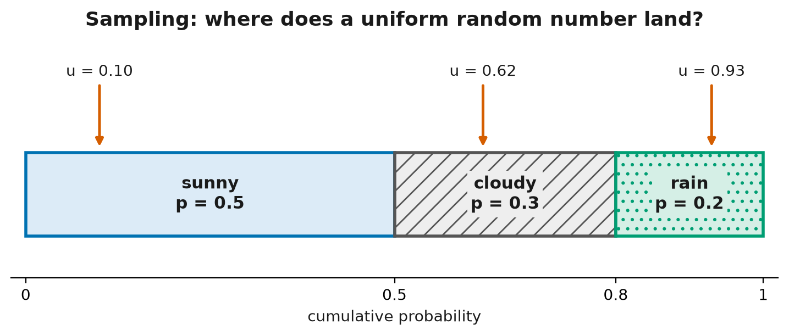

# Probability for Generative Models

> **TL;DR** — A generative model doesn't produce one fixed answer. It produces a set of
> probabilities for what could come next, picks one at random according to those probabilities,
> and repeats. This lesson builds that loop from scratch with Brindlewick's weather: count what
> follows what, turn the counts into probabilities, sample, and score whole sequences with the
> chain rule.

## Learning objectives

By the end you will be able to:

1. **Compute** joint, marginal and conditional probabilities from a table of counts.
2. **Compute** the probability of a whole sequence with the chain rule, using log-probabilities.
3. **Implement** sampling from a categorical distribution using one uniform random number.
4. **Explain** generation as repeated sampling from conditional distributions, and why the same
   model gives different outputs on different runs.

## Why this matters

When you send the same prompt to a language model twice and get two different answers, you're
seeing sampling. When a model scores how likely a sentence is, it's applying the chain rule. When
someone reports that a model "assigns low probability" to a fact, they mean a conditional
probability. Each of these is a small idea, and together they're the whole generation process.

Misunderstanding them leads to real mistakes: reading a model's output as its single "belief",
expecting identical results from runs that sample, or multiplying thousands of small probabilities
and getting exactly zero. This lesson covers the probability you need for the rest of the
catalog, and nothing more.

## 🟢 Core idea (everyone)

### From counts to probabilities

L0-01 defined a probability distribution: how likely each possible outcome is, with all the
probabilities adding up to 1. The simplest way to get one is to count.

Brindlewick's weather station labels every day as sunny, cloudy or rain. Its log contains 100
pairs of consecutive days, and each pair records today's weather and tomorrow's:

| Today ↓ / Tomorrow → | sunny | cloudy | rain | Row total |
|---|---|---|---|---|
| **sunny** | 35 | 10 | 5 | 50 |
| **cloudy** | 10 | 12 | 8 | 30 |
| **rain** | 5 | 8 | 7 | 20 |

From this one table you can read three different kinds of probability.

**Joint probability** is the chance that two things happen together. Of the 100 pairs, 5 were
"sunny today and rain tomorrow", so

$$
P(\text{today} = \text{sunny},\ \text{tomorrow} = \text{rain}) = \frac{5}{100} = 0.05
$$

$P(\ldots)$ is read "the probability of", and the comma is read "and".

**Marginal probability** is the chance of one thing, whatever the other does. Add across a row:
50 of 100 days were sunny, so $P(\text{today} = \text{sunny}) = 0.5$. Likewise cloudy is 0.3 and
rain is 0.2. (The name comes from writing these totals in the margin of the table.)

**Conditional probability** is the chance of one thing *given* that another is known. If today
is sunny, look only at the sunny row: 5 of those 50 days were followed by rain.

$$
P(\text{tomorrow} = \text{rain} \mid \text{today} = \text{sunny}) = \frac{5}{50} = 0.1
$$

The bar $\mid$ is read "given". Compare the rain row: if today is rainy, tomorrow is rainy with
probability $7/20 = 0.35$. Knowing today changes the forecast, from 0.1 to 0.35. That change is
the whole point of a conditional probability, and it's what makes generation coherent: what comes
next depends on what came before.

Dividing every row by its total gives the full table of conditional probabilities. Each row is a
distribution of its own, so each row adds up to 1:

| Today ↓ / P(tomorrow) → | sunny | cloudy | rain |
|---|---|---|---|
| **sunny** | 0.700 | 0.200 | 0.100 |
| **cloudy** | 0.333 | 0.400 | 0.267 |
| **rain** | 0.250 | 0.400 | 0.350 |

### Sampling: making a random choice the fair way

To generate tomorrow's weather, you don't just take the most likely option. You sample (L0-01): pick
at random, so that each outcome comes up as often as its probability says. If today is sunny,
you should pick sunny 70% of the time, cloudy 20% and rain 10%.

A distribution over a fixed list of outcomes like this is called a **categorical
distribution**. Here's how to sample from one, using nothing but a random number between 0 and 1.
Lay the outcomes along a strip from 0 to 1, each taking up as much of the strip as its
probability. Then drop a random number $u$ onto the strip. The strip below uses the overall
weather mix from the counts table, $P(\text{today})$: sunny 0.5, cloudy 0.3 and rain 0.2.



*Each outcome owns a slice of the strip as wide as its probability, so a uniformly random point lands in each slice exactly that often.*

The random number must be **uniform**: every value between 0 and 1 equally likely. Then it
lands in the sunny slice half the time, because that slice is half the strip. The slice
boundaries (0.5, 0.8 and 1) are running totals of the probabilities, called the **cumulative
distribution**.

**An analogy.** Sampling is like a raffle where each outcome holds tickets in proportion to its
probability: sunny holds 50 of 100 tickets, cloudy 30 and rain 20. You draw one ticket.

**Where the analogy breaks down:** a raffle has a whole number of tickets, so it can't represent a
probability like 1/3 exactly, while a random point on a strip can. And in a real model, the
"ticket holders" change on every draw, because the distribution depends on everything generated
so far.

### Generation is repeated sampling

Now combine the two ideas. Start from today's weather, look up the conditional distribution for
tomorrow, sample it, and treat the result as the new "today". Repeat.


*Generation loops through three steps: get the distribution for the next item, sample from it, and append the result.*

Here's a fortnight generated this way, starting from a sunny day:

```text
sunny sunny cloudy rain sunny sunny cloudy sunny cloudy rain cloudy sunny sunny sunny
```

Nobody wrote this forecast down; it's new. Yet it's plausible: long sunny spells, rain that
usually follows clouds. Run it again with a different random seed and you get a different, equally
plausible fortnight.

This is how a language model writes. Swap "weather" for tokens (L0-01) and three outcomes
for a vocabulary of, say, 50,000. At each step the model computes a conditional distribution over
every possible next token, given all the text so far, samples one, appends it, and repeats. A
model that generates this way, each new piece conditioned on the pieces before it, is called
**autoregressive**.

### Scoring a whole sequence: the chain rule

How likely is the three-day sequence sunny, sunny, rain? Break it into steps and multiply:

$$
P(\text{sunny}, \text{sunny}, \text{rain}) = P(\text{sunny}) \times P(\text{sunny} \mid \text{sunny}) \times P(\text{rain} \mid \text{sunny}) = 0.5 \times 0.7 \times 0.1 = 0.035
$$

This is the **chain rule of probability**: the probability of a sequence is the probability of
the first item, times the probability of each next item given what came before. Language models
use exactly this to score a sentence: multiply the probability of each token given the tokens
before it.

## 🟡 How it works (practitioner)

### The weather model in code

[code/weather_chain.py](code/weather_chain.py) computes every table above from the counts, using
NumPy. Run it from this lesson's folder:

```bash
python code/weather_chain.py
```

The three probabilities take three lines:

```python
joint = JOINT_COUNTS / JOINT_COUNTS.sum()          # P(today, tomorrow)
marginal = joint.sum(axis=1)                       # P(today): add across each row
transitions = joint / marginal[:, np.newaxis]      # P(tomorrow | today) = joint / marginal
```

The last line is the definition of conditional probability:

$$
P(B \mid A) = \frac{P(A, B)}{P(A)}
$$

In words: of all the times $A$ happens, what fraction also have $B$? `marginal[:, np.newaxis]`
reshapes the marginals into a column, so that NumPy divides each *row* of the joint table by that
row's marginal.

Generation is one line inside a loop. `rng.choice(3, p=transitions[today])` samples an outcome
using the row for today:

```python
while len(sequence) < days:
    today = sequence[-1]
    sequence.append(int(rng.choice(len(STATES), p=transitions[today])))
```

The output ends with a check. Generate 10,000 days and count them:

```text
share of days in 10,000 generated days: sunny 0.498  cloudy 0.297  rain 0.204
```

Those shares are close to the marginals, 0.5, 0.3 and 0.2. Over many samples, frequencies settle
near the true probabilities. That's the **law of large numbers**, and it's how you test any
sampler.

### A sampler from scratch

[code/sampling.py](code/sampling.py) implements the strip from the core section:

```python
def sample_categorical(probs: np.ndarray, u: float) -> int:
    total = 0.0
    for outcome, p in enumerate(probs):
        total += p
        if u < total:
            return outcome
    return len(probs) - 1  # guards against rounding when the probabilities sum to 0.99999...
```

Running it compares this sampler with NumPy's at three sample sizes:

```text
sample frequencies (ours, then NumPy's):
       10 draws: sunny 0.300 cloudy 0.400 rain 0.300 | sunny 0.500 cloudy 0.200 rain 0.300
      100 draws: sunny 0.450 cloudy 0.290 rain 0.260 | sunny 0.460 cloudy 0.280 rain 0.260
   10,000 draws: sunny 0.501 cloudy 0.298 rain 0.201 | sunny 0.494 cloudy 0.307 rain 0.200
```

With 10 draws, the frequencies are far from 0.5, 0.3 and 0.2. With 10,000, both samplers are
within about 0.01. Small samples are noisy. Keep that in mind whenever you evaluate a model on a
handful of generated outputs.

### Where a model's probabilities come from: softmax

A count table works for three weather types. A neural network instead computes a list of
arbitrary real numbers, one score per possible outcome (often called **logits**). Scores can
be negative and don't sum to 1. The **softmax** function turns them into a distribution:

$$
\text{softmax}(z)_i = \frac{e^{z_i}}{\sum_j e^{z_j}}
$$

Here $z$ is the list of scores, $z_i$ is the score of outcome $i$, and $e^{z_i}$ is the exponential
function ($e \approx 2.718$ raised to the power $z_i$), which makes every value positive. Dividing by
the sum makes them add up to 1. For scores 2.0, 1.0 and 0.5:

| Outcome | Score $z_i$ | $e^{z_i}$ | Probability |
|---|---|---|---|
| sunny | 2.0 | 7.389 | 7.389 / 11.756 = 0.629 |
| cloudy | 1.0 | 2.718 | 0.231 |
| rain | 0.5 | 1.649 | 0.140 |

Higher scores get higher probabilities, and the ordering is always kept. You'll build models that
output scores in L1-06, and adjust how "peaked" the distribution is (temperature) in L2-10.

### Expected value

The **expected value** of a numeric outcome is its probability-weighted average: multiply each
value by its probability and add. If Brindlewick's noon temperature averages 18 °C on sunny days,
14 °C on cloudy days and 11 °C on rainy days, the expected noon temperature on a random day is

$$
0.5 \times 18 + 0.3 \times 14 + 0.2 \times 11 = 15.4\ °\text{C}
$$

No single day need be 15.4 °C; it's the long-run average. L1-03 defines entropy as an expected
value, and L1-05 defines a model's loss as one.

### Log-probabilities

Multiplying many probabilities gives numbers too small for a computer to store. The last part of
`sampling.py` shows it:

```text
1,000 tokens, each with probability 0.1:
  multiplying probabilities: 0.0
  adding log-probabilities:  -2302.585
```

The true answer is $10^{-1000}$, but the smallest positive normal number a standard 64-bit float can
hold is about $10^{-308}$ (special subnormal values reach about $10^{-324}$, still nowhere near),
so the product rounds to exactly 0. This is called **underflow**. The fix is
to work with the **log-probability** (the natural logarithm of a probability) and use the rule
$\log(a \times b) = \log a + \log b$: multiplying probabilities becomes adding log-probabilities.
Log-probabilities are always zero or negative, and closer to 0 means more likely.

### Common pitfalls

- **Rows that don't sum to 1.** `rng.choice(..., p=...)` raises an error if the probabilities
  don't sum to 1 (within a small tolerance). Normalize after any edit.
- **Confusing $P(A \mid B)$ with $P(B \mid A)$.** $P(\text{rain tomorrow} \mid \text{cloudy
  today})$ is 0.267, but $P(\text{cloudy today} \mid \text{rain tomorrow})$ is $8/20 = 0.4$.
  They answer different questions.
- **Zero counts become impossible events.** If a pair never appeared in the data, its
  probability is 0 and it can never be generated, and any sequence containing it scores 0. L1-03
  shows why that's a serious problem for measuring a model.
- **Unseeded randomness.** Without a fixed seed, every run differs, so bugs are hard to
  reproduce. The catalog's examples always fix the seed (L0-06).
- **Judging a sampler on a few draws.** As the 10-draw row shows, small samples mislead.

## 🔴 Going deeper (expert)

### The chain rule is exact; the model is the approximation

For any sequence $x_1, \ldots, x_n$, the chain rule holds with no assumptions at all:

$$
P(x_1, \ldots, x_n) = \prod_{t=1}^{n} P(x_t \mid x_1, \ldots, x_{t-1})
$$

The symbol $\prod$ means "multiply together", here over every position $t$ from 1 to $n$. Every
autoregressive model, from this weather model to a large language model, is an attempt to
estimate the factors on the right.

The weather model makes an extra assumption: tomorrow depends on today only, not on earlier days.
That's the **Markov assumption**, and a process that follows it is a **Markov chain**. It turns
$P(x_t \mid x_1, \ldots, x_{t-1})$ into $P(x_t \mid x_{t-1})$. N-gram models (L0-03) extend it to the
previous $n-1$ items. Transformers drop it within their context window and condition on every
earlier token, which is a large part of why they work.

Why not just count longer contexts? A full table for contexts of length $k$ over a vocabulary of
$V$ tokens has $V^k$ rows of $V$ probabilities each. With $V = 50{,}000$ and $k = 2$, that's
$1.25 \times 10^{14}$ numbers, and almost every row would be empty. Neural models replace the table
with a function that computes the distribution from vectors (L1-01), so similar contexts share
parameters. Bengio and colleagues framed this as fighting the *curse of dimensionality* in 2003.

### Long-run behaviour and the stationary distribution

The 10,000-day run landed on the marginals 0.5, 0.3 and 0.2. That's no accident. A distribution
$\pi$ that the chain leaves unchanged, $\pi^\top T = \pi^\top$ for a transition matrix $T$, is called a
**stationary distribution**. Under mild conditions (every state reachable from every other, and no fixed cycle),
a Markov chain's long-run frequencies converge to its unique stationary distribution from any
start. This chain's joint count table is symmetric (10 sunny→cloudy pairs and 10 cloudy→sunny,
and so on), so the marginals are exactly stationary. Markov chain Monte Carlo methods, used to
sample from hard distributions, and the noise processes in diffusion models (L2-13) both rely on
this kind of long-run behaviour.

### The most likely sequence is not a typical sequence

The single most likely 14-day sequence is 14 sunny days, with probability
$0.5 \times 0.7^{13} \approx 0.0048$. Yet you'd almost never sample it, and the samples you do get
have rain and clouds. With $3^{14} \approx 4.8$ million possible sequences, a lot of probability sits
in the many "typical" ones rather than in the single best.

Language models show the same effect, much amplified. Always choosing the most likely next token
(greedy decoding) tends to produce bland, repetitive text, while sampling produces more varied
and often more natural text, with more risk of going off-track. L2-10 covers the trade-off and
the decoding methods that sit between the two.

### Bayes' rule: reasoning backwards

Rearranging the definition of conditional probability gives **Bayes' rule**:

$$
P(A \mid B) = \frac{P(B \mid A)\, P(A)}{P(B)}
$$

It lets you reason from an effect back to a cause. If today is rainy, how likely is it that
yesterday was sunny? $P(\text{yesterday sunny} \mid \text{rain}) = 0.1 \times 0.5 / 0.2 = 0.25$.
Generative models are often described as modelling $P(\text{data})$ or
$P(\text{data} \mid \text{condition})$, while discriminative models estimate $P(\text{label} \mid \text{data})$
directly (L0-01); Bayes' rule connects the two.

### Sampling at scale

The strip method costs $O(V)$ per draw (it may scan every outcome). With precomputed cumulative
totals, a binary search takes $O(\log V)$. A popular alternative is the **Gumbel-max trick**: add
independent Gumbel-distributed noise to each log-probability and take the largest. The winner is
an exact sample from the distribution, and the work parallelizes across outcomes, which suits
hardware that processes many numbers at once. In a language model, sampling is rarely the
bottleneck: computing the scores is.

## Common misconceptions

- **Myth:** A model's output is its one answer.
  **Reality:** The model produces a distribution, and the output is one sample from it. Another
  run can give a different, equally valid sample.
- **Myth:** Sampling means choosing the most likely option.
  **Reality:** Sampling picks each option as often as its probability. Always choosing the most
  likely option is a separate strategy, called greedy decoding.
- **Myth:** $P(A \mid B)$ and $P(B \mid A)$ are the same thing.
  **Reality:** They are usually different. Bayes' rule converts one into the other.
- **Myth:** A probability of 0.035 for a sequence means the model thinks it's unlikely.
  **Reality:** Long sequences always have small probabilities, because there are so many
  possible sequences. Compare probabilities of sequences of the same length, or use the average
  per-step log-probability (L1-03).

## Hands-on exercise

**Goal:** score every three-day weather sequence with the chain rule, and confirm that the
probabilities form a valid distribution.

Open [exercises/three_day_forecasts.py](exercises/three_day_forecasts.py) and complete
`sequence_log_prob()` and `sample_categorical()`, which samples by dropping one uniform number
onto the strip. Before running, predict the most likely three-day sequence, and the
probability of three rainy days. For a stretch goal, estimate P(rain, rain, rain) by generating
sequences and counting.

You've succeeded when the 27 probabilities add up to 1.000000 and the strip check matches the
strip diagram: 0.10 lands in sunny, 0.62 in cloudy and 0.93 in rain.

<details>
<summary>Solution</summary>

The full solution is in
[exercises/solutions/three_day_forecasts.py](exercises/solutions/three_day_forecasts.py):

```python
total = math.log(START[sequence[0]])
for today, tomorrow in zip(sequence, sequence[1:]):
    total += math.log(TRANSITIONS[today, tomorrow])
return total

# sample_categorical: walk the running totals until u falls below one
running = 0.0
for i, p in enumerate(probs):
    running += p
    if u < running:
        return i
return len(probs) - 1    # guard: totals can add up to 0.99999...
```

```text
27 sequences, probabilities sum to 1.000000
most likely:
  sunny sunny sunny     0.2450   log-prob -1.406
  sunny sunny cloudy    0.0700   log-prob -2.659
  cloudy sunny sunny    0.0700   log-prob -2.659
P(rain, rain, rain) = 0.0245
strip check: u = 0.10 -> sunny, u = 0.62 -> cloudy, u = 0.93 -> rain
estimated from 100,000 generated sequences: 0.0250
```

The probabilities must sum to 1 because the 27 sequences cover every possible outcome exactly
once: the chain rule splits the total probability of 1 across the first day, then splits each
share across the second day, and so on. If your sum is anything else, a factor is wrong.

$P(\text{rain}, \text{rain}, \text{rain}) = 0.2 \times 0.35 \times 0.35 = 0.0245$. The estimate from
100,000 samples, 0.0250, is close. With only 1,000 samples you'd expect about 25 hits, and the
estimate can easily be off by 20% or more.

</details>

## Check your understanding

1. Using the count table, what is $P(\text{tomorrow} = \text{cloudy} \mid \text{today} = \text{rain})$?

   - A. 0.08
   - B. 0.30
   - C. 0.40
   - D. 0.27

   <details>
   <summary>Answer</summary>

   **C.** Look only at the rain row: 8 of its 20 days were followed by cloudy, and
   $8/20 = 0.4$. A (0.08) is the *joint* probability, 8 out of all 100 pairs. B (0.30) is the
   marginal probability of a cloudy day. D (0.27) is $P(\text{rain} \mid \text{cloudy})$, which
   reverses the condition.

   </details>

2. Which of these are true of a categorical distribution? *(choose all that apply)*

   - A. Its probabilities add up to 1
   - B. The most likely outcome is chosen every time you sample from it
   - C. It can be sampled with one uniform random number and the cumulative totals
   - D. Each probability is between 0 and 1

   <details>
   <summary>Answer</summary>

   **A, C, D.** A and D are what makes it a distribution, and C is the strip method from this
   lesson. B describes greedy choice, not sampling: sampling picks each outcome as often as its
   probability says.

   </details>

3. A model gives these conditional probabilities for a three-token sentence: 0.2 for the first
   token, 0.5 for the second given the first, and 0.1 for the third given the first two. What is
   the probability of the sentence?

   - A. 0.8
   - B. 0.01
   - C. 0.267
   - D. 0.1

   <details>
   <summary>Answer</summary>

   **B.** By the chain rule, $0.2 \times 0.5 \times 0.1 = 0.01$. A adds the probabilities instead
   of multiplying. C averages them. D takes only the last factor.

   </details>

4. You run the same weather model twice from the same starting day and get two different
   fortnights. A colleague says the code must have a bug. What do you tell them, and how would
   you make the runs repeatable?

   <details>
   <summary>Model answer</summary>

   Different outputs are expected: the model samples, so each run makes different random choices,
   and both fortnights are valid samples from the same distribution. To make runs repeatable,
   create the random-number generator with a fixed seed, such as
   `np.random.default_rng(seed=7)`. The same seed always produces the same sequence of random
   numbers, so the same samples.

   </details>

5. **Explain it to a colleague:** in plain language, how does a language model "write" a
   sentence, and why does it use probabilities rather than picking one fixed next word?

   <details>
   <summary>Model answer</summary>

   It writes one token at a time. At each step it works out, from all the text so far, a
   probability for every possible next token, picks one at random according to those
   probabilities, adds it to the text and repeats. Probabilities let it represent that many
   continuations are reasonable, with some more likely than others. Sampling from them produces
   varied, natural text, whereas always taking the single most likely token tends to produce
   bland, repetitive text. The same mechanism explains why one prompt can give different answers.

   </details>

## Key terms

- [Autoregressive model](../../../GLOSSARY.md#autoregressive-model)
- [Bayes' rule](../../../GLOSSARY.md#bayes-rule)
- [Categorical distribution](../../../GLOSSARY.md#categorical-distribution)
- [Chain rule of probability](../../../GLOSSARY.md#chain-rule-of-probability)
- [Conditional probability](../../../GLOSSARY.md#conditional-probability)
- [Cumulative distribution](../../../GLOSSARY.md#cumulative-distribution)
- [Expected value](../../../GLOSSARY.md#expected-value)
- [Gumbel-max trick](../../../GLOSSARY.md#gumbel-max-trick)
- [Joint probability](../../../GLOSSARY.md#joint-probability)
- [Law of large numbers](../../../GLOSSARY.md#law-of-large-numbers)
- [Log-probability](../../../GLOSSARY.md#log-probability)
- [Logits](../../../GLOSSARY.md#logits)
- [Marginal probability](../../../GLOSSARY.md#marginal-probability)
- [Markov assumption](../../../GLOSSARY.md#markov-assumption)
- [Markov chain](../../../GLOSSARY.md#markov-chain)
- [Softmax](../../../GLOSSARY.md#softmax)
- [Stationary distribution](../../../GLOSSARY.md#stationary-distribution)
- [Underflow](../../../GLOSSARY.md#underflow)
- [Uniform distribution](../../../GLOSSARY.md#uniform-distribution)

## Further reading

- 🟢 **Seeing Theory** — D. Kunin, J. Guo, T. D. Devlin and D. Xiang (Brown University). Free
  interactive visual introduction to probability. <https://seeing-theory.brown.edu/>
- 🟡 **Introduction to Probability** — J. K. Blitzstein and J. Hwang (2nd ed., 2019). CRC Press.
  A clear, example-driven textbook. It covers conditional probability, expectation and Markov
  chains in more depth.
- 🟡 **Mathematics for Machine Learning** — M. P. Deisenroth, A. A. Faisal and C. S. Ong (2020).
  Chapter 6 covers probability and distributions with machine learning in mind.
  <https://mml-book.github.io/>
- 🔴 **Speech and Language Processing**, chapter "N-gram Language Models" — D. Jurafsky and
  J. H. Martin (3rd ed. draft). Language modelling with counts, the chain rule and the Markov
  assumption. <https://web.stanford.edu/~jurafsky/slp3/>
- 🔴 **A Neural Probabilistic Language Model** — Y. Bengio, R. Ducharme, P. Vincent and
  C. Jauvin (2003). *Journal of Machine Learning Research*, 3, 1137–1155. Why count tables fail
  for long contexts, and the neural alternative.

## Next

- **Next lesson:** [L1-03 Information Basics: Entropy, Cross-Entropy, Perplexity, KL](../03-information-basics/README.md)
- **Related:** L1-06 trains a model that outputs scores and uses softmax. L2-10 covers decoding
  strategies (greedy, temperature, top-k, top-p). L2-13 uses noise and sampling in diffusion models.
