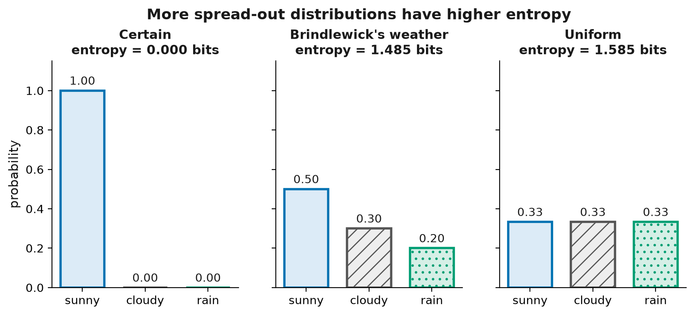

# Information Basics: Entropy, Cross-Entropy, Perplexity, KL

> **TL;DR** — Surprise can be measured: an outcome you gave probability $p$ costs $-\log_2 p$
> bits when it happens. Entropy is how surprised you expect to be when your probabilities are
> right. Cross-entropy is how surprised you actually are when you use a model's probabilities.
> The gap between them is the KL divergence. Perplexity turns cross-entropy into an "effective
> number of choices". Language models are trained by lowering cross-entropy, so these four
> numbers are how you'll read every training curve in this catalog.

## Learning objectives

By the end you will be able to:

1. **Compute** surprisal, entropy, cross-entropy, KL divergence and perplexity for a small
   distribution, by hand and in NumPy.
2. **Explain** why cross-entropy is the loss that language models are trained to lower.
3. **Interpret** a perplexity value, and say when two perplexities can't be compared.
4. **Diagnose** why a model that gives any real outcome probability 0 gets an infinite score.

## Why this matters

L1-02 showed that a generative model produces probabilities. This lesson answers the next
question: how good are those probabilities? You need one number that rewards a model for putting
high probability on what actually happens, and punishes it for being confidently wrong.

That number is cross-entropy. It's the loss language models are trained to lower, it's what
the "loss" axis on a training curve shows, and perplexity, a common headline result in language
modelling papers, is just cross-entropy in different units. When someone says a model "reached a
loss of 2.1", this lesson is what lets you read that.

## 🟢 Core idea (everyone)

### Surprise has a size

Brindlewick's weather, from L1-02, is sunny half the time, cloudy 30% of the time and rainy 20%.
A sunny day surprises nobody. A rainy day is a bit more surprising. A snowstorm in July, which
you'd give a probability of maybe 1 in 100, is very surprising.

Information theory, founded by Claude Shannon in 1948, measures this with **surprisal** (also
called information content):

$$
\text{surprisal}(x) = -\log_2 p(x)
$$

Here $p(x)$ is the probability you gave outcome $x$, and $\log_2$ is the logarithm base 2: the
power you raise 2 to in order to get a number, so $\log_2 8 = 3$. The unit is the **bit**.

| Outcome | Probability | Surprisal |
|---|---|---|
| sunny | 0.5 | 1.000 bits |
| cloudy | 0.3 | 1.737 bits |
| rain | 0.2 | 2.322 bits |
| a 1-in-100 event | 0.01 | 6.644 bits |
| something certain | 1.0 | 0 bits |


*Surprisal falls as probability rises, and shoots up without limit as probability approaches zero.*

Why a logarithm? Three reasons, each worth knowing:

- **Certain things carry no information.** $\log_2 1 = 0$.
- **Rarer things carry more.** As $p$ shrinks, $-\log_2 p$ grows.
- **Surprises add up.** Two independent events with probabilities $\tfrac{1}{2}$ and $\tfrac{1}{4}$
  happen together with probability $\tfrac{1}{8}$, and $1 + 2 = 3$ bits. Logarithms turn
  multiplying probabilities into adding surprisals, the same trick as log-probabilities in L1-02.

One bit is the surprise of a fair coin landing on a particular side. A rainy day in Brindlewick
is "worth" about 2.3 coin flips of surprise.

### Entropy: how unpredictable is the weather?

**Entropy** is the average surprisal you expect, when the outcomes really do follow your
probabilities. It's an **expected value** (L1-02): weight each surprisal by its probability, then
add.

$$
H(P) = -\sum_x P(x) \log_2 P(x)
$$

The $\sum_x$ means "add up over every outcome $x$". For the weather:

$$
H = 0.5 \times 1.000 + 0.3 \times 1.737 + 0.2 \times 2.322 = 1.485 \text{ bits}
$$



*Entropy is zero when the outcome is certain, and highest when every outcome is equally likely.*

A distribution where one outcome is certain has entropy 0. A three-way coin toss, with each outcome at 1/3, has
the most entropy possible for three outcomes, $\log_2 3 = 1.585$ bits. Brindlewick's weather sits
in between: a little predictable, mostly not.

**An analogy.** Entropy is like the average number of yes-or-no questions you'd need to find out
the weather, if you ask cleverly. Ask "Is it sunny?" first. Half the time you're done after one
question; otherwise ask "Is it cloudy?". That takes $0.5 \times 1 + 0.5 \times 2 = 1.5$ questions
on average, very close to 1.485.

**Where the analogy breaks down:** you can't ask 1.485 questions, so a question-asking strategy
for a single day can only approach the entropy. You get closer to it by asking about many days at
once, which is what compression software does. The analogy also hides that entropy is a property
of the *distribution*, not of any one day.

### Cross-entropy: how surprised does a forecaster make you?

Now suppose a forecaster doesn't know the true distribution $P$. They publish their own
probabilities $Q$, and the real weather keeps happening according to $P$. Each day, you score
the forecaster by the surprisal of what actually happened, *under their probabilities*. Their
average score is the **cross-entropy**:

$$
H(P, Q) = -\sum_x P(x) \log_2 Q(x)
$$

The outcomes are weighted by how often they really happen ($P$), but the surprise is measured with
the forecaster's probabilities ($Q$). Four forecasters, scored against Brindlewick's real weather:

| Forecaster | Their Q (sunny, cloudy, rain) | Cross-entropy | Perplexity |
|---|---|---|---|
| honest | 0.50, 0.30, 0.20 | 1.485 bits | 2.800 |
| uniform | 0.33, 0.33, 0.33 | 1.585 bits | 3.000 |
| sunny-ish | 0.70, 0.20, 0.10 | 1.618 bits | 3.070 |
| no-rain | 0.60, 0.40, 0.00 | infinite | infinite |

The honest forecaster scores lowest, and that isn't luck: no forecaster can beat the true
probabilities on average (🔴 explains why). Every other forecaster pays extra bits. And the
no-rain forecaster, who called rain *impossible*, gets an infinite score the first time it rains,
because $-\log_2 0$ is infinite. One impossible outcome that happens ruins the whole average.

### Perplexity: an effective number of choices

Bits are hard to picture. **Perplexity** converts cross-entropy back into a count:

$$
\text{perplexity} = 2^{H(P, Q)}
$$

The uniform forecaster's perplexity is exactly 3: it's as uncertain as someone choosing among 3
equally likely options. The honest forecaster's 2.8 means it's as uncertain as choosing among
about 2.8 options. Lower perplexity means the model is less "perplexed" by what it sees.

For language models, a character model that guesses uniformly among 27 symbols (26 letters and a
space) has perplexity 27. A model with perplexity 10 on some text is, on average, as uncertain as
if it were choosing among 10 equally likely next tokens at every step.

### Why this is how language models are trained

A language model sees training text, and at every position it gives a probability to the token
that actually comes next. The training goal is to make the average surprisal of those real next
tokens as small as possible. That average is the model's cross-entropy on the text. A function
that measures how wrong a model is, which training then tries to make smaller, is called a
**loss function**, and cross-entropy is the standard loss function for language models.

So the "loss" in a training log is an average surprisal per token, and lowering it means the
model is getting less surprised by real text. L1-05 shows how training lowers a loss.

## 🟡 How it works (practitioner)

### The four quantities in NumPy

[code/entropy_and_friends.py](code/entropy_and_friends.py) computes everything above. Run it from
this lesson's folder:

```bash
python code/entropy_and_friends.py
```

The definitions are short:

```python
def surprisal(p):
    with np.errstate(divide="ignore"):   # log2(0) is -inf; let it through quietly
        return -np.log2(p)

def entropy(p):
    nonzero = p > 0                      # outcomes with p = 0 never happen, so contribute 0
    return float(np.sum(p[nonzero] * surprisal(p[nonzero])))

def cross_entropy(p, q):
    nonzero = p > 0
    return float(np.sum(p[nonzero] * surprisal(q[nonzero])))

def kl_divergence(p, q):
    return cross_entropy(p, q) - entropy(p)
```

The `nonzero` filter in `entropy` follows the convention that $0 \log 0 = 0$: an outcome that
never happens adds no surprise. In `cross_entropy`, it's $p$ that's filtered, not $q$, so an
outcome that really happens but has $q = 0$ still produces infinity. That's the correct answer,
not a bug.

### KL divergence: the extra cost of being wrong

The **Kullback–Leibler (KL) divergence** is the gap between cross-entropy and entropy:

$$
D_{\mathrm{KL}}(P \parallel Q) = H(P, Q) - H(P) = \sum_x P(x) \log_2 \frac{P(x)}{Q(x)}
$$

It measures how many extra bits per outcome you pay for using $Q$ when the truth is $P$. From the
script's output:

```text
forecaster   Q                    cross-entropy   KL(P||Q)   perplexity
  honest     (0.50, 0.30, 0.20)      1.485 bits    0.000      2.800
  uniform    (0.33, 0.33, 0.33)      1.585 bits    0.099      3.000
  sunny-ish  (0.70, 0.20, 0.10)      1.618 bits    0.133      3.070
  no-rain    (0.60, 0.40, 0.00)        inf bits      inf        inf
```

The honest forecaster's KL is 0. Everyone else's is positive. KL is often described as a
"distance" between distributions, but it isn't one in the strict sense, because it isn't
symmetric:

```text
KL is not symmetric:
  KL(P || sunny-ish) = 0.133 bits
  KL(sunny-ish || P) = 0.123 bits
```

Which distribution goes first matters, and 🔴 shows that the choice changes how a model behaves.

### Scoring text: cross-entropy on data

In practice, you don't know the true distribution $P$. You have text, which is a *sample* from it.
So you estimate cross-entropy by averaging the surprisal of the model over the text itself:

$$
H \approx \frac{1}{N} \sum_{t=1}^{N} -\log_2 Q(x_t \mid x_1, \ldots, x_{t-1})
$$

Here $N$ is the number of tokens, $x_t$ is the token at position $t$, and the conditional
probability comes from the chain rule (L1-02). This average of negative log-probabilities is also
called the **negative log-likelihood** (NLL): the **likelihood** of a text is the probability a
model gives it, and the NLL per token is exactly the cross-entropy estimate above.

[code/score_text.py](code/score_text.py) scores text with three tiny character models. Each
"model" is just a table of probabilities for the 27 symbols, built from a 354-character
paragraph about Brindlewick:

```text
training text: 354 characters   test text: 80 characters
symbols in the test text that never appear in training: ['j', 'z']

model      train bits/char  train perplexity   test bits/char  test perplexity
  uniform         4.755           27.00              4.755           27.00
  counted         4.075           16.85                inf             inf
  smoothed        4.087           16.99              4.248           19.00
```

Three lessons are packed into this table:

- **Uniform gives exactly 27.** $\log_2 27 = 4.755$ bits, and $2^{4.755} = 27$.
- **Counting from data helps.** Knowing that "e" and space are common lowers perplexity from 27
  to about 17 on the training text.
- **Unseen symbols break an unsmoothed model.** The test sentence contains "j" and "z", which the
  training paragraph never used. The counted model gives them probability 0, so its test
  cross-entropy is infinite. **Smoothing**, here adding 1 to every count so nothing has
  probability 0, fixes it, at a small cost on the training text. It also shows the usual gap:
  every model that learned from the training text does worse on new text (19.00 vs 16.99).
  Always report scores on **held-out data**, text the model didn't learn from.

### Bits or nats?

Most training code uses the natural logarithm, $\ln$, instead of $\log_2$. Then the unit is the
**nat**, and perplexity is $e^{\text{loss}}$ instead of $2^{\text{loss}}$. The two units differ by
a constant: 1 nat = $1/\ln 2 \approx 1.443$ bits. A loss of 2.1 nats per token is about 3.03 bits
per token, and either way the perplexity is $e^{2.1} \approx 8.2$. Perplexity doesn't depend on
the base, as long as you raise the matching base.

### Common pitfalls

- **Comparing perplexities across tokenizers.** Perplexity is *per token*. A model that splits
  text into more, smaller tokens has an easier job per token and can look better while being no
  better at all. Compare models only on the same tokens, or convert to bits per character or per
  byte, which don't depend on the tokenizer.
- **Mixing log bases.** A loss in nats and a loss in bits for the same model differ by a factor of
  1.443. Check which one a number is before you compare it.
- **Scoring on training data.** Training cross-entropy is optimistic. Report held-out numbers.
- **Zero probabilities.** Any outcome a model says is impossible will, eventually, happen in real
  data. Smooth count-based models, and check that a model's probabilities are never exactly 0.
- **Reading low perplexity as "correct".** Perplexity measures how predictable text is to a model,
  not whether the text is true. A fluent false sentence can have low perplexity.

## 🔴 Going deeper (expert)

### Gibbs' inequality: the truth always wins on average

KL divergence is never negative, and it's zero only when $Q = P$:

$$
D_{\mathrm{KL}}(P \parallel Q) \ge 0
$$

This is **Gibbs' inequality**. It follows from Jensen's inequality, because $\log$ is a concave
function. Its consequence is the reason cross-entropy works as a loss: since $H(P, Q) = H(P) +
D_{\mathrm{KL}}(P \parallel Q)$ and $H(P)$ is fixed by the data, the cross-entropy is lowest
exactly when the model's probabilities match the true ones. A scoring rule with this property,
where honest probabilities give the best expected score, is called a **proper scoring rule**.
Log-loss (cross-entropy) is one. Accuracy, which only checks the top guess, is not: it can't tell a model that's
51% sure from one that's 99% sure.

It also explains a limit: on average (in expectation), no model can get a cross-entropy below
the entropy of the data. A small test set can dip below it by chance. If
language has some irreducible unpredictability, a language model's loss can approach that floor
but never cross it.

### Maximum likelihood is minimizing KL

Training a model on data by **maximum likelihood** means choosing parameters that give the
training data the highest probability. Since the log is increasing, that's the same as minimizing
the NLL, which is the cross-entropy between the **empirical distribution** (the data's own
frequencies) and the model. And since the data's entropy doesn't depend on the model, it's also
the same as minimizing $D_{\mathrm{KL}}(P_{\text{data}} \parallel Q_{\text{model}})$. Three names
describe one objective: maximize likelihood, minimize cross-entropy, minimize forward KL.

### Forward and reverse KL behave differently

Because KL isn't symmetric, the direction you minimize changes the model you get. Suppose the
truth $P$ has two separate peaks and your model $Q$ can only make one.

- **Forward KL**, $D_{\mathrm{KL}}(P \parallel Q)$, the maximum-likelihood direction, punishes $Q$
  heavily wherever $P$ has probability and $Q$ doesn't (the no-rain disaster). So $Q$ spreads out
  to cover both peaks, even if that puts probability in the valley between them. This is called
  **mode-covering**.
- **Reverse KL**, $D_{\mathrm{KL}}(Q \parallel P)$, punishes $Q$ for putting probability where $P$
  has little. So $Q$ tends to settle on one peak and ignore the other. This is called
  **mode-seeking**.

Both directions appear in generative modelling. Language-model pretraining uses forward KL (via
cross-entropy). Variational methods such as the variational autoencoder (L2-12) are usually built
around reverse KL. Reinforcement-learning methods that keep a fine-tuned model close to a
reference model often add a KL penalty between the two (L7-07).

### Perplexity, entropy rate and compression

For text, the meaningful quantity is the **entropy rate**: the average entropy of the next symbol
given all the previous ones, in the limit of long text. Shannon (1951) estimated the entropy rate
of printed English with human prediction experiments, getting bounds of roughly 0.6 to 1.3 bits
per character when people could see a long stretch of preceding text. The counted model above (a
*unigram* model: it ignores context), at about 4.1 bits per character, is nowhere near that, because it ignores context entirely.
TODO(verify): confirm the 0.6–1.3 bits-per-character range against Shannon (1951), table and
experimental conditions.

Cross-entropy is also a compression rate. A method called **arithmetic coding** can use a model's
probabilities to encode text in, on average, very close to the model's cross-entropy in bits per
symbol. So a better predictor is literally a better compressor, and the reverse. Delétang and
colleagues (2023) made this link concrete, using large language models as general-purpose
compressors for text, images and audio. Whether "compression" fully explains what these models
learn is an open debate.

### Calibration: probabilities you can take at face value

A model is calibrated (L0-04) if, among all the times it says 70%, the event happens about 70% of the
time. Cross-entropy rewards calibration, because it's proper. But a model can be well calibrated
and still unhelpful (always predicting the long-run frequencies is calibrated), and later training
stages can change calibration. Treat a model's stated confidence as evidence, not as a guarantee.
L7-11 returns to this in the science of evaluation.

## Common misconceptions

- **Myth:** Lower perplexity always means a better model.
  **Reality:** Only when the test text and the tokenizer are the same. Across tokenizers or
  datasets, the numbers aren't comparable.
- **Myth:** KL divergence is the distance between two distributions.
  **Reality:** It's not symmetric, so it isn't a distance. $D_{\mathrm{KL}}(P \parallel Q)$ and
  $D_{\mathrm{KL}}(Q \parallel P)$ are different numbers, and minimizing each gives different models.
- **Myth:** Entropy measures disorder or messiness in the text.
  **Reality:** Here it measures unpredictability under a distribution. The same text has different
  cross-entropy under different models.
- **Myth:** A training loss near zero means the model is excellent.
  **Reality:** On average, no model's held-out loss can go below the entropy of the text, so a near-zero
  *training* loss usually means the model memorized its training text. Check the held-out loss
  (L1-05).

## Hands-on exercise

**Goal:** rank weather forecasters by cross-entropy, and see what a short test log can do to the
ranking.

Open [exercises/which_forecaster.py](exercises/which_forecaster.py). Five forecasters each see
yesterday's weather and forecast today: `climate` (always 0.5, 0.3, 0.2), `persistence` ("same as
yesterday" at 0.8), `transition` (the L1-02 table, which is how the generated weather really
works), `no_rain` (certain it never rains), and `smoothed_no_rain`. Complete `average_surprisal()`,
then predict the ranking on the 14-day fortnight and on 5,000 generated days before running.

You've succeeded when you can explain why the rankings differ.

<details>
<summary>Solution</summary>

The full solution is in
[exercises/solutions/which_forecaster.py](exercises/solutions/which_forecaster.py):

```python
def average_surprisal(probabilities):
    if any(p == 0 for p in probabilities):
        return math.inf
    return sum(-math.log2(p) for p in probabilities) / len(probabilities)
```

```text
the fortnight: 13 forecasts scored
  climate           cross-entropy  1.430 bits/day   perplexity  2.695
  transition        cross-entropy  1.487 bits/day   perplexity  2.803
  smoothed_no_rain  cross-entropy  1.601 bits/day   perplexity  3.034
  persistence       cross-entropy  2.399 bits/day   perplexity  5.274
  no_rain           cross-entropy    inf bits/day   perplexity    inf
5,000 generated days: 4,999 forecasts scored
  transition        cross-entropy  1.332 bits/day   perplexity  2.518
  climate           cross-entropy  1.474 bits/day   perplexity  2.777
  persistence       cross-entropy  1.643 bits/day   perplexity  3.124
  smoothed_no_rain  cross-entropy  1.770 bits/day   perplexity  3.410
  no_rain           cross-entropy    inf bits/day   perplexity    inf
```

On 13 forecasts, `climate` beats `transition`, even though `transition` knows the real rules.
Thirteen days is too few: a couple of lucky days decide the order. On 4,999 forecasts,
`transition` wins clearly, as Gibbs' inequality says it must on average. `no_rain` is infinite on
both logs, because it rains at least once and it called rain impossible. Smoothing makes it finite
but still poor, because it still badly underrates rain.

The lesson for evaluating real models: score on enough held-out data, and treat small differences
on small test sets with suspicion.

</details>

## Check your understanding

1. A model gave the token that actually came next a probability of 0.25. What is its surprisal?

   - A. 0.25 bits
   - B. 2 bits
   - C. 4 bits
   - D. −2 bits

   <details>
   <summary>Answer</summary>

   **B.** $-\log_2 0.25 = 2$ bits, because $2^2 = 4$ and $0.25 = 1/4$. C confuses surprisal
   with $1/p$, which is the corresponding "number of choices". D forgets the minus sign, and
   surprisal is never negative.

   </details>

2. Which of these are true? *(choose all that apply)*

   - A. Cross-entropy is never smaller than the entropy of the true distribution
   - B. KL divergence is symmetric: swapping P and Q gives the same number
   - C. A model that gives a real outcome probability 0 has infinite cross-entropy on data
     containing it
   - D. Perplexity equals 2 raised to the cross-entropy in bits

   <details>
   <summary>Answer</summary>

   **A, C, D.** A is Gibbs' inequality, since cross-entropy is entropy plus a KL divergence that's
   never negative. C follows from $-\log_2 0 = \infty$. D is the definition. B is false: the
   lesson's sunny-ish forecaster gives 0.133 bits one way and 0.123 bits the other.

   </details>

3. Two teams report perplexity on the same test text. Team A reports 12 using a tokenizer with
   short tokens. Team B reports 20 using a tokenizer with long tokens. What can you conclude?

   - A. Team A's model is better, because its perplexity is lower
   - B. Team B's model is better, because longer tokens are harder to predict
   - C. Nothing yet: per-token perplexities from different tokenizers aren't comparable
   - D. The models are equally good, because perplexity doesn't depend on the tokenizer

   <details>
   <summary>Answer</summary>

   **C.** Perplexity is per token, and the two tokenizers cut the same text into different numbers
   of tokens. Convert both to bits per character (or per byte) of the same text, which doesn't
   depend on how the text was split, and then compare. A and B each assume a comparison the numbers
   can't support, and D is the opposite of the truth.

   </details>

4. A training log shows a loss of 2.3 nats per token on held-out text. What is the perplexity,
   and roughly how many bits per token is the loss? Then, by hand: a fair coin is
   $P = (0.5, 0.5)$ and a model predicts $Q = (0.75, 0.25)$. What is $D_{\mathrm{KL}}(P \parallel Q)$
   in bits?

   <details>
   <summary>Model answer</summary>

   The loss is in nats, so perplexity is $e^{2.3} \approx 10$: on average the model is as
   uncertain as choosing among about 10 equally likely tokens. In bits, $2.3 \times 1.443 \approx
   3.3$ bits per token, and $2^{3.3} \approx 10$ gives the same perplexity, as it must.

   For the coin:

   $$
   D_{\mathrm{KL}}(P \parallel Q) = 0.5 \log_2 \frac{0.5}{0.75} + 0.5 \log_2 \frac{0.5}{0.25}
   \approx 0.5 \times (-0.585) + 0.5 \times 1 \approx 0.208 \text{ bits}
   $$

   That's the extra surprisal per toss from using the model instead of the truth. (The reverse direction,
   $D_{\mathrm{KL}}(Q \parallel P)$, is about 0.189 bits, not the same.)

   </details>

5. **Explain it to a colleague:** in plain language, what does it mean that a language model is
   "trained to minimize cross-entropy", and why is that a sensible goal?

   <details>
   <summary>Model answer</summary>

   At every position in the training text, the model gives a probability to every possible next
   token. We look at the probability it gave the token that really came next, and measure how
   surprised it was: a low probability means high surprise. Cross-entropy is the average of that
   surprise over the text, and training adjusts the model to make the average smaller. It's
   sensible because it rewards putting high probability on what really happens and punishes being
   confidently wrong, and the best possible score on average comes from matching the true
   probabilities, so the model is pushed towards realistic probabilities rather than lucky guesses.

   </details>

## Key terms

- [Arithmetic coding](../../../GLOSSARY.md#arithmetic-coding)
- [Bit](../../../GLOSSARY.md#bit)
- [Cross-entropy](../../../GLOSSARY.md#cross-entropy)
- [Empirical distribution](../../../GLOSSARY.md#empirical-distribution)
- [Entropy](../../../GLOSSARY.md#entropy)
- [Entropy rate](../../../GLOSSARY.md#entropy-rate)
- [Forward KL](../../../GLOSSARY.md#forward-kl)
- [Gibbs' inequality](../../../GLOSSARY.md#gibbs-inequality)
- [Held-out data](../../../GLOSSARY.md#held-out-data)
- [KL divergence](../../../GLOSSARY.md#kl-divergence)
- [Likelihood](../../../GLOSSARY.md#likelihood)
- [Loss function](../../../GLOSSARY.md#loss-function)
- [Maximum likelihood](../../../GLOSSARY.md#maximum-likelihood)
- [Mode-covering](../../../GLOSSARY.md#mode-covering)
- [Mode-seeking](../../../GLOSSARY.md#mode-seeking)
- [Nat](../../../GLOSSARY.md#nat)
- [Negative log-likelihood](../../../GLOSSARY.md#negative-log-likelihood)
- [Perplexity](../../../GLOSSARY.md#perplexity)
- [Proper scoring rule](../../../GLOSSARY.md#proper-scoring-rule)
- [Reverse KL](../../../GLOSSARY.md#reverse-kl)
- [Smoothing](../../../GLOSSARY.md#smoothing)
- [Surprisal](../../../GLOSSARY.md#surprisal)

## Further reading

- 🟢 **Information Theory, Inference, and Learning Algorithms** — D. J. C. MacKay (2003).
  Cambridge University Press. Free to read online; chapters 1–2 introduce entropy with many
  examples. <https://www.inference.org.uk/mackay/itila/>
- 🟡 **Elements of Information Theory** — T. M. Cover and J. A. Thomas (2nd ed., 2006). Wiley.
  Chapter 2 covers entropy, relative entropy (KL) and the information inequality (Gibbs'
  inequality) with proofs.
- 🟡 **Speech and Language Processing**, chapter "N-gram Language Models" — D. Jurafsky and
  J. H. Martin (3rd ed. draft). Perplexity, smoothing and evaluating language models.
  <https://web.stanford.edu/~jurafsky/slp3/>
- 🔴 **A Mathematical Theory of Communication** — C. E. Shannon (1948). *Bell System Technical
  Journal*, 27, 379–423 and 623–656. The paper that defined entropy for communication.
- 🔴 **Prediction and Entropy of Printed English** — C. E. Shannon (1951). *Bell System Technical
  Journal*, 30, 50–64. Human-prediction estimates of the entropy of English.
- 🔴 **Language Modeling Is Compression** — G. Delétang et al. (2023). arXiv:2309.10668.
  <https://arxiv.org/abs/2309.10668>

## Next

- **Next lesson:** [L1-04 Derivatives, Gradients and the Chain Rule](../04-derivatives-gradients-chain-rule/README.md)
- **Related:** L1-05 lowers a loss with gradient descent. L1-06 trains a bigram model by
  minimizing cross-entropy. L2-12 meets KL divergence again in variational autoencoders.
