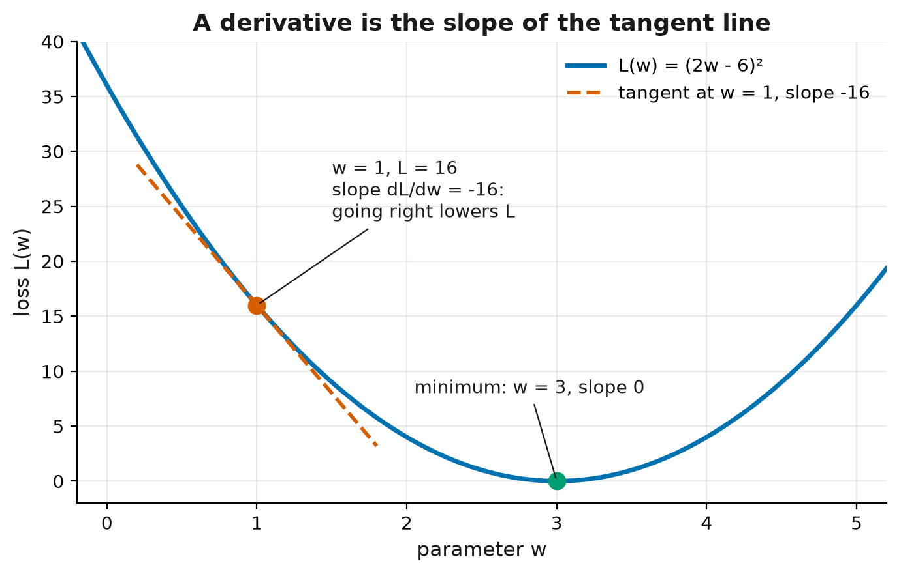

# Derivatives, Gradients and the Chain Rule

> **TL;DR** — Training a model means nudging its numbers so the loss goes down. To know which
> way to nudge, you need the slope of the loss with respect to each number: its derivative. A
> gradient is all those slopes collected into one vector. The chain rule lets you get slopes of
> big functions by multiplying the slopes of their small steps, which is exactly what
> backpropagation does. This lesson computes all three by hand and checks every one numerically.

## Learning objectives

By the end you will be able to:

1. **Estimate** a derivative numerically with forward and central differences, and explain why
   the step size can be neither too big nor too small.
2. **Compute** partial derivatives and the gradient of a function of several inputs.
3. **Apply** the chain rule to a composed function, using a forward pass and a backward pass on
   a computational graph.
4. **Check** a hand-written gradient against a numerical estimate.

## Why this matters

L1-03 showed that a language model is judged by a loss: its cross-entropy on real text. A model
with billions of **parameters** (the adjustable numbers inside it, L0-02) is trained by
repeatedly asking, for every parameter at once, "if I nudge this number up a little, does the loss
go up or down, and by how much?" The answer is the gradient. Every gradient-trained model in
this catalog, from the trained bigram model in L1-06 to TinyLM, uses it.

You won't compute gradients by hand for real models: software does it. But when training goes
wrong (the loss explodes, stalls, or turns into "not a number"), the cause is almost always
visible in the gradients, and you can only read them if you know what they are.

## 🟢 Core idea (everyone)

### A derivative is a slope

Take a simple loss that depends on one parameter $w$:

$$
L(w) = (2w - 6)^2
$$

This is smallest, exactly 0, at $w = 3$. Suppose $w$ is currently 1, so the loss is
$(2 - 6)^2 = 16$. Should you increase $w$ or decrease it?

The **derivative** answers that. It's the slope of the function at a point: how much the output
changes per unit change in the input, for a very small change. It's written $\frac{dL}{dw}$,
read "d L by d w", or $L'(w)$.



*At w = 1 the curve slopes steeply downwards, so increasing w lowers the loss; at the minimum the slope is zero.*

The dashed line just touches the curve at $w = 1$. It's called the **tangent line**, and its
slope is the derivative there: $-16$. Two things to read from it:

- **The sign says which way is downhill.** A negative slope means increasing $w$ lowers $L$.
- **The size says how steep it is.** A slope of $-16$ means a tiny step of 0.01 to the right
  lowers $L$ by about 0.16.

At the minimum the slope is 0: the curve is flat, and there's no downhill direction left.
Training is, at heart, "follow the slope downhill until it's flat".

### Estimate it by nudging

You don't need calculus rules to get a derivative. Nudge the input by a small step $h$ and
measure the change:

$$
\frac{dL}{dw} \approx \frac{L(w + h) - L(w)}{h}
$$

This is a **finite difference**. With $w = 1$ and $h = 0.001$: $L(1.001) = (2.002 - 6)^2 =
15.984004$, so the slope is about $(15.984004 - 16) / 0.001 = -15.996$. Close to $-16$, and closer
as $h$ shrinks. The exact derivative is the value this ratio approaches as $h$ shrinks towards 0.

### Many inputs: partial derivatives and the gradient

Real losses depend on many parameters at once. Take a function of two inputs:

$$
g(x, y) = x^2 + 3xy
$$

A **partial derivative** is the slope in one input's direction, with all the others held still.
It's written with a curly $\partial$: $\frac{\partial g}{\partial x}$ is the slope as $x$
changes and $y$ stays fixed. At the point $(1, 2)$:

- Holding $y = 2$, $g = x^2 + 6x$, whose slope is $2x + 6 = 8$ at $x = 1$.
- Holding $x = 1$, $g = 1 + 3y$, whose slope is $3$.

Collect all the partial derivatives into a vector (L1-01) and you have the **gradient**, written
$\nabla g$ ("nabla g" or "grad g"):

$$
\nabla g(1, 2) = \left( \frac{\partial g}{\partial x}, \frac{\partial g}{\partial y} \right) = (8, 3)
$$

The gradient points in the direction of steepest *increase*. So to lower a loss, step in the
opposite direction, $-\nabla L$. That's **gradient descent**, and L1-05 builds it.

**An analogy.** You're standing on a hillside in thick fog and want to reach the valley. You
can't see the valley, but you can feel the slope under your feet in every direction. The gradient
is that feeling: it tells you which way is steepest uphill, and you walk the other way.

**Where the analogy breaks down:** a hillside has two directions to feel, and a model has millions
or billions. And you can't actually "feel" a model's slopes for free: computing them takes real
work, which is what the chain rule and backpropagation make affordable.

### The chain rule: slopes of steps multiply

Big functions are built from small steps. $L(w) = (2w - 6)^2$ is two steps: first compute
$u = 2w - 6$, then $L = u^2$. The **chain rule** says the slope of the whole is the product of the
slopes of the steps:

$$
\frac{dL}{dw} = \frac{dL}{du} \times \frac{du}{dw}
$$

Each step's slope is easy on its own:

- $u = 2w - 6$ changes by 2 for each unit of $w$, so $\frac{du}{dw} = 2$.
- $L = u^2$ has slope $2u$, which at $u = -4$ is $-8$.

Multiply: $\frac{dL}{dw} = -8 \times 2 = -16$, the same slope as the tangent line.

It makes intuitive sense. If nudging $w$ moves $u$ twice as far, and nudging $u$ moves $L$ eight
times as far (downwards), then nudging $w$ moves $L$ sixteen times as far (downwards). Slopes
compound like exchange rates: dollars to euros to yen is the product of the two rates.

**Where the analogy breaks down:** an exchange rate is the same whatever amount you convert, but a
local slope changes from point to point ($2u$ depends on $u$). That's why the backward pass needs
the values from the forward pass.

A neural network is the same idea with thousands of steps. The chain rule lets you get the slope
of the final loss with respect to any parameter, however deep inside it sits, by multiplying
local slopes along the way.

## 🟡 How it works (practitioner)

### Finite differences in code

[code/derivatives.py](code/derivatives.py) estimates the derivative of $f(x) = x^3$ at $x = 2$,
where the exact answer is $3x^2 = 12$. Run it from this lesson's folder:

```bash
python code/derivatives.py
```

It compares two ways of nudging:

```python
def forward_difference(func, x, h):
    return (func(x + h) - func(x)) / h

def central_difference(func, x, h):
    return (func(x + h) - func(x - h)) / (2 * h)
```

The **central difference** takes a step each way and measures across both:

```text
     h       forward    error       central    error
  0.1       12.61000  6.1e-01    12.01000  1.0e-02
  0.01      12.06010  6.0e-02    12.00010  1.0e-04
  0.001     12.00600  6.0e-03    12.00000  1.0e-06
```

Shrinking $h$ by 10 shrinks the forward difference's error by 10, but the central difference's by
100. The central difference's errors on the two sides largely cancel, which is why gradient
checking uses it.

### Smaller isn't always better

So why not use $h = 10^{-14}$? The next part of the output answers that:

```text
smaller is not always better (central difference):
  h = 1e-02   error 1.0e-04
  h = 1e-05   error 2.1e-10
  h = 1e-08   error 7.3e-08
  h = 1e-11   error 9.9e-07
  h = 1e-14   error 1.2e-01
```

The error falls until about $h = 10^{-5}$ and then rises again. A computer stores about 16
significant digits. When $h$ is tiny, $f(x + h)$ and $f(x - h)$ agree in almost all of those
digits, and subtracting them leaves mostly rounding noise, which is then divided by the tiny
$2h$ and magnified. Two errors pull in opposite directions: the formula's error (big $h$) and
rounding error (small $h$). For central differences in 64-bit floats, $h$ around $10^{-5}$ to
$10^{-6}$ is a good default.

### Gradients in code

`numerical_gradient` nudges each input in turn, holding the others still, which is exactly the
definition of a partial derivative:

```python
def numerical_gradient(func, point, h=1e-5):
    grad = np.zeros_like(point, dtype=float)
    for i in range(len(point)):
        step = np.zeros_like(point, dtype=float)
        step[i] = h
        grad[i] = (func(point + step) - func(point - step)) / (2 * h)
    return grad
```

```text
g(x, y) = x^2 + 3xy at (1, 2):
  gradient by hand:      [8. 3.]
  gradient by nudging:   [8. 3.]
```

Notice the cost: two function evaluations *per input*. For a model with a billion parameters,
that's two billion evaluations of the whole model for one gradient. Numerical gradients are for
*checking*, never for training.

### Computational graphs: forward pass and backward pass

The cheap way to get gradients is to apply the chain rule systematically. Draw the function as a
**computational graph**: each box is one simple step, and arrows show which values feed which
steps.


*The forward pass computes and remembers each value; the backward pass starts from 1 at the output and multiplies by each step's local slope.*

Two passes:

1. **Forward pass.** Compute each step from left to right, and remember every intermediate value
   ($u = -4$). The backward pass needs them.
2. **Backward pass.** Start at the output with $\frac{dL}{dL} = 1$. Move right to left,
   multiplying by each step's **local derivative**: the slope of that one step with respect to its
   own input, using the values remembered from the forward pass.

[code/chain_rule_by_hand.py](code/chain_rule_by_hand.py) does exactly this, step by step:

```python
u = 2 * w - 6          # forward: inner step
loss = u ** 2          # forward: outer step
dloss_du = 2 * u       # backward: local slope of u^2
du_dw = 2              # backward: local slope of 2w - 6
dloss_dw = dloss_du * du_dw
```

```text
Part 1: L(w) = (2w - 6)^2 at w = 1
  forward:  u = 2w - 6 = -4.0   L = u^2 = 16.0
  backward: dL/du = 2u = -8.0   du/dw = 2   dL/dw = -16.0
  numerical check: -16.000000
```

### A real model in miniature

Part 2 of the same file is a model with two parameters: it predicts $z = wx + b$ from an input $x$
(a weight $w$ and a **bias** $b$, a constant added on; this bias is just a parameter, unrelated
to the unfairness meaning of bias in L0-04), and its loss is the squared error against
the correct answer $y$:

$$
L(w, b) = (wx + b - y)^2
$$

With one training example, $x = 2$ and $y = 7$, and current parameters $w = 1$, $b = 0.5$:

```text
Part 2: L(w, b) = (w*x + b - y)^2 with x = 2, y = 7, w = 1, b = 0.5
  forward:  prediction z = 2.5   error r = -4.5   L = 20.25
  backward: dL/dr = -9.0   dL/dw = -18.0   dL/db = -9.0
  numerical check: dL/dw = -18.000000   dL/db = -9.000000
  one step downhill (step size 0.05): w = 1.90, b = 0.95, L = 5.0625
```

The backward pass shares work. $\frac{dL}{dr} = 2r = -9$ is computed once and reused for both
parameters: $\frac{dL}{dw} = -9 \times x = -18$ and $\frac{dL}{db} = -9 \times 1 = -9$. The
gradient $(-18, -9)$ says both parameters should go up. One step against the gradient (scaled by
a step size of 0.05) cuts the loss from 20.25 to about 5.06. That's one step of training. L1-05
repeats it until the loss stops falling.

### Common pitfalls

- **Forgetting to remember forward values.** Local derivatives like $2u$ need the value of $u$
  from the forward pass. Autograd systems (software that computes gradients automatically, built in L1-08) store these, which is why training uses much more
  memory than just running a model.
- **Sign errors.** The gradient points uphill. Training steps go in the *negative* gradient
  direction.
- **Using the wrong $h$.** Too large and the formula's error dominates; too small and rounding
  dominates. Use central differences with $h$ around $10^{-5}$.
- **Comparing absolute errors.** A difference of 0.001 is tiny for a gradient of 1,000 and huge
  for a gradient of 0.001. Compare **relative error** instead (the exercise does).
- **Trusting a gradient you haven't checked.** A wrong gradient doesn't crash anything. Training
  just goes badly, which is much harder to diagnose. Check new gradient code numerically, once,
  on small inputs.

## 🔴 Going deeper (expert)

### Jacobians: when outputs are vectors too

A function from $n$ inputs to $m$ outputs has $m \times n$ partial derivatives: how each output
changes with each input. Arranged in a matrix, they form the **Jacobian**, $J_{ij} =
\frac{\partial y_i}{\partial x_j}$. The gradient is the special case $m = 1$. For a chain of
vector-valued steps, the chain rule becomes a product of Jacobians: $J_{\text{total}} = J_k \cdots
J_2 J_1$, a sequence of matrix–matrix products (L1-01).

### Forward mode and reverse mode

That product can be evaluated in either order. Multiplying from the input side is **forward-mode
differentiation**: one pass gives the derivatives of all outputs with respect to *one* input.
Multiplying from the output side is **reverse-mode** differentiation: one pass gives the
derivatives of *one* output with respect to all inputs.

A training loss is one output depending on millions or billions of parameters, so reverse mode
wins by a huge margin. A well-known result in automatic differentiation is that the reverse pass
costs a small constant multiple of the forward pass, independent of the number of parameters.
That's why training is affordable at all. Reverse-mode differentiation applied to neural networks
is called backpropagation (named in L0-03), and its use for training multi-layer networks was popularized by
Rumelhart, Hinton and Williams in 1986. L1-08 builds a tiny reverse-mode autograd engine.

The price is memory: reverse mode must keep the forward pass's intermediate values until the
backward pass uses them. Techniques like gradient checkpointing trade extra computation (redoing
parts of the forward pass) for less memory.

### Choosing h, more precisely

The forward difference's formula error shrinks in proportion to $h$; the central difference's in
proportion to $h^2$. Rounding error grows roughly in proportion to $\varepsilon / h$, where
$\varepsilon \approx 2.2 \times 10^{-16}$ is the gap between 1 and the next 64-bit float. Balancing
the two terms puts the best $h$ for central differences near $\varepsilon^{1/3} \approx 6 \times
10^{-6}$, which matches the minimum in the table above. For forward differences, the balance is
near $\sqrt{\varepsilon} \approx 1.5 \times 10^{-8}$, with a much larger best-case error.

### Kinks, vanishing and exploding

- **Kinks.** Many networks use ReLU, $\max(0, x)$, whose slope is 0 for negative inputs and 1 for
  positive ones, with a corner at 0. There, the derivative doesn't exist; software simply picks a
  value (usually 0). Gradient checks near a kink can fail spuriously, because the two nudges land
  on different sides of the corner.
- **Products of many slopes.** The backward pass multiplies one local slope per step. Through 50
  steps, slopes of 0.5 give $0.5^{50} \approx 10^{-15}$ (a **vanishing gradient**: early
  parameters barely learn), and slopes of 1.5 give $1.5^{50} \approx 6 \times 10^8$ (an
  **exploding gradient**: training diverges). Residual connections, normalization and careful
  initialization (L1-09, L2-05) exist largely to keep this product near 1.

### The gradient of softmax plus cross-entropy

Part 3 of `chain_rule_by_hand.py` takes scores $z$, applies softmax (L1-02) to get probabilities
$p$, and computes the cross-entropy loss $-\ln p_{\text{target}}$ (L1-03). Chaining the
derivatives of the logarithm and the softmax gives a remarkably simple result:

$$
\frac{\partial L}{\partial z_i} = p_i - y_i
$$

Here $y$ is a **one-hot vector**: 1 at the position of the true outcome, 0 everywhere else.

```text
Part 3: softmax then cross-entropy, scores [2.0, 1.0, 0.5], true outcome 0
  p = softmax(scores) = [0.629 0.231 0.14 ]   loss = 0.464 nats
  gradient p - y:      [-0.371  0.231  0.14 ]
  numerical check:     [-0.371  0.231  0.14 ]
```

Read it as: raise the true outcome's score (its gradient is negative), and lower every other
score in proportion to the probability it wrongly took. This is the gradient at the output of
every language model during training, so you'll meet it again in L1-06 and L1-08.

## Common misconceptions

- **Myth:** The gradient points towards the minimum.
  **Reality:** It points in the direction of steepest *increase* from where you stand, locally.
  Its negative is locally steepest downhill, which need not aim at the lowest point.
- **Myth:** Computers find derivatives by nudging each parameter.
  **Reality:** That's far too slow for training. Frameworks apply the chain rule exactly, in
  reverse mode. Nudging is only used to check that code.
- **Myth:** A gradient of zero means you've found the best parameters.
  **Reality:** It means the surface is flat there. That can be a minimum, a maximum, a saddle
  point (uphill in some directions, downhill in others), or a plateau.
- **Myth:** Backpropagation is a special neural-network algorithm.
  **Reality:** It's the chain rule, applied from the output backwards, reusing shared work. The
  same technique differentiates any program built from differentiable steps.

## Hands-on exercise

**Goal:** build a gradient checker, and use it to find a buggy hand-written gradient.

Open [exercises/check_my_gradient.py](exercises/check_my_gradient.py). It has four functions, each
with a gradient derived by hand, and one of those gradients is wrong. Complete
`numerical_gradient()` (central differences) and `relative_error()`, run the file, and find the
bug by redoing that derivative yourself.

You've succeeded when exactly one function is flagged and you can say what's wrong with it.

<details>
<summary>Solution</summary>

The full solution is in
[exercises/solutions/check_my_gradient.py](exercises/solutions/check_my_gradient.py):

```python
def numerical_gradient(func, w, h=1e-5):
    grad = np.zeros_like(w)
    for i in range(len(w)):
        step = np.zeros_like(w)
        step[i] = h
        grad[i] = (func(w + step) - func(w - step)) / (2 * h)
    return grad

def relative_error(a, b):
    return float(np.linalg.norm(a - b) / max(np.linalg.norm(a) + np.linalg.norm(b), 1e-12))
```

```text
sum_of_squares         relative error below 1e-9   ok
wave                   relative error below 1e-9   ok
growth                 relative error 2.6e-01      WRONG
softmax_cross_entropy  relative error below 1e-9   ok
```

`growth` is $e^{w_0 w_1}$. By the chain rule, with inner step $u = w_0 w_1$:
$\frac{\partial}{\partial w_1} = e^{u} \times \frac{\partial u}{\partial w_1} = w_0 e^{w_0 w_1}$.
The hand-written gradient forgot the inner factor $w_0$ in the second entry, a very common
chain-rule mistake. The fix is `return np.array([w[1] * e, w[0] * e])`.

For the stretch task: with $h = 10^{-2}$, the formula's own error grows. `wave` and
`softmax_cross_entropy` rise to a few times $10^{-6}$, just over the script's $10^{-6}$ threshold,
so they print `WRONG` even though they're right. `sum_of_squares` stays tiny, because the central
difference is exact for a quadratic. With $h = 10^{-12}$, rounding noise takes over and every
correct gradient lands around $10^{-5}$ to $10^{-4}$ (the exact values vary by machine), also
flagged. Even so, all of them stay more than a thousand times below the buggy gradient's 0.26.
A threshold only means something for a sensible $h$; with a bad one, look at how far apart the
errors are.

</details>

## Check your understanding

1. At $w = 4$, what is the derivative of $L(w) = (2w - 6)^2$?

   - A. 4
   - B. 8
   - C. 16
   - D. −16

   <details>
   <summary>Answer</summary>

   **C.** With $u = 2w - 6 = 2$: $\frac{dL}{du} = 2u = 4$ and $\frac{du}{dw} = 2$, so
   $\frac{dL}{dw} = 4 \times 2 = 16$. A forgets to multiply by the inner slope, B doubles the loss value
   $L(4) = 4$ instead of finding a slope, and D is the slope at $w = 1$, on the other side of the minimum.

   </details>

2. Which of these are true of the gradient of a loss? *(choose all that apply)*

   - A. It has one entry per parameter
   - B. It points in the direction that increases the loss fastest
   - C. Training takes a step in the direction of the gradient
   - D. It's zero at a minimum of a smooth loss

   <details>
   <summary>Answer</summary>

   **A, B, D.** The gradient collects one partial derivative per parameter (A), points uphill
   (B), and is zero where the surface is flat, including at a minimum (D). C is backwards:
   training steps against the gradient, downhill.

   </details>

3. Why does gradient checking use a central difference with $h \approx 10^{-5}$, rather than
   $h = 10^{-14}$?

   - A. Smaller steps are slower to compute
   - B. With a tiny $h$, rounding error in the subtraction swamps the result
   - C. The central difference only works for large $h$
   - D. $h = 10^{-14}$ can't be stored as a 64-bit float

   <details>
   <summary>Answer</summary>

   **B.** With a tiny step, $f(x + h)$ and $f(x - h)$ agree in nearly all their digits, so their
   difference is mostly rounding noise, which dividing by $2h$ magnifies. The lesson's output
   shows an error of 0.12 at $h = 10^{-14}$. A is false (the cost doesn't depend on $h$), C is
   false, and D is false: 64-bit floats can store values down to about $10^{-308}$.

   </details>

4. A model has 10 million parameters. Roughly how many evaluations of the loss would a numerical
   gradient need, and how does backpropagation avoid this?

   <details>
   <summary>Model answer</summary>

   Central differences need two evaluations per parameter, so about 20 million evaluations of the
   whole loss for one gradient. Backpropagation instead does one forward pass, remembering
   intermediate values, and one backward pass that applies the chain rule from the loss back to
   every parameter, reusing shared work. That costs a small constant multiple of a single forward
   pass, no matter how many parameters there are.

   </details>

5. **Explain it to a colleague:** in plain language, what is the chain rule, and why does it
   matter for training neural networks?

   <details>
   <summary>Model answer</summary>

   When a calculation is built from steps, the rate at which the final result changes with an
   input is the product of the rates of each step along the way, like converting currency through
   two exchange rates. A neural network is a long chain of simple steps ending in a loss. The chain
   rule lets us work out, for every parameter, how the loss would change if we nudged that
   parameter, by multiplying local slopes backwards from the loss. That gradient tells training
   which way to adjust each parameter, and doing it backwards in one pass is what makes it cheap
   enough to train models with billions of parameters.

   </details>

## Key terms

- [Backpropagation](../../../GLOSSARY.md#backpropagation)
- [Bias (parameter)](../../../GLOSSARY.md#bias-parameter)
- [Central difference](../../../GLOSSARY.md#central-difference)
- [Chain rule](../../../GLOSSARY.md#chain-rule)
- [Computational graph](../../../GLOSSARY.md#computational-graph)
- [Derivative](../../../GLOSSARY.md#derivative)
- [Exploding gradient](../../../GLOSSARY.md#exploding-gradient)
- [Finite difference](../../../GLOSSARY.md#finite-difference)
- [Forward pass](../../../GLOSSARY.md#forward-pass)
- [Forward-mode differentiation](../../../GLOSSARY.md#forward-mode-differentiation)
- [Gradient](../../../GLOSSARY.md#gradient)
- [Gradient checking](../../../GLOSSARY.md#gradient-checking)
- [Gradient descent](../../../GLOSSARY.md#gradient-descent)
- [Jacobian](../../../GLOSSARY.md#jacobian)
- [Local derivative](../../../GLOSSARY.md#local-derivative)
- [One-hot vector](../../../GLOSSARY.md#one-hot-vector)
- [Partial derivative](../../../GLOSSARY.md#partial-derivative)
- [Relative error](../../../GLOSSARY.md#relative-error)
- [Reverse-mode differentiation](../../../GLOSSARY.md#reverse-mode-differentiation)
- [Tangent line](../../../GLOSSARY.md#tangent-line)
- [Vanishing gradient](../../../GLOSSARY.md#vanishing-gradient)

## Further reading

- 🟢 **Essence of Calculus** — 3Blue1Brown (G. Sanderson). Free animated video series on
  derivatives and the chain rule. <https://www.3blue1brown.com/topics/calculus>
- 🟡 **Mathematics for Machine Learning** — M. P. Deisenroth, A. A. Faisal and C. S. Ong (2020).
  Chapter 5, "Vector Calculus", covers gradients, Jacobians and backpropagation.
  <https://mml-book.github.io/>
- 🟡 **CS231n course notes: Backpropagation, Intuitions** — Stanford University. Computational
  graphs and backward passes worked through small examples.
  <https://cs231n.github.io/optimization-2/>
- 🔴 **Automatic Differentiation in Machine Learning: a Survey** — A. G. Baydin, B. A.
  Pearlmutter, A. A. Radul and J. M. Siskind (2018). *Journal of Machine Learning Research*, 18.
  Forward and reverse mode, and how frameworks implement them. <https://arxiv.org/abs/1502.05767>
- 🔴 **Evaluating Derivatives** — A. Griewank and A. Walther (2nd ed., 2008). SIAM. The standard
  reference on automatic differentiation, including the cost of reverse mode.
- 🔴 **Learning representations by back-propagating errors** — D. E. Rumelhart, G. E. Hinton and
  R. J. Williams (1986). *Nature*, 323, 533–536.

## Next

- **Next lesson:** L1-05 Learning from Data: Loss, Gradient Descent and Generalization (coming
  in Module 1B).
- **Related:** L1-08 builds a tiny autograd engine that automates the backward pass. L1-09 covers
  initialization and normalization, which tame vanishing and exploding gradients.
